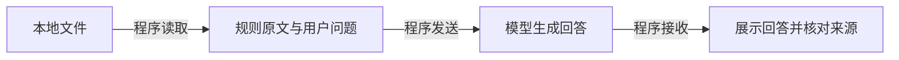

# C00：从一次资料问答认识 LLM

你可能已经用过聊天或编程助手，却还说不清它为什么能回答、什么时候会出错。本讲从一个小任务开始，认识大语言模型（Large Language Model，LLM）与应用怎样配合。无需先学线性代数、模型训练或任何 Agent 框架。

学完后，你应能解释：**模型拿到了哪些信息，文字怎样生成，程序做了哪些操作，以及怎样检查结果。** 这也是进入 C01 讨论系统方案的起点。[基础知识地图](../../prerequisite.md) 用于查范围；这里提供连续讲解。首次摸底用于选择需要学习的部分，不要求你在学习前就认识全部术语。

## 从一个问题开始

假设我们正在制作“本地学习资料助手”。它要根据 Markdown 文件回答问题，给出来源；资料没有提供的信息，就说明缺口。先看已有教学资料 [limits.md](../labs/C01-materials/limits.md) 中的一条规则：

> 单次任务最多执行 3 次工具调用。

这里的“工具调用”可以先理解为程序执行一次读取或搜索操作，第四块会展开。

用户问：“一次任务最多允许执行多少次工具调用？”

你读到规则后可以回答。但计算机中的模型如何得到这条规则？如果只给它文件名，或者让它回答“这次任务花了多少钱”，又会怎样？下面四块内容都围绕这些问题展开。资料是虚构案例，本讲的交互是机制示意，没有调用真实模型。

| 学习块 | 要弄清的问题 | 学完后接到哪里 |
| --- | --- | --- |
| 一：模型与应用 | 文件怎样变成模型可用的信息？ | C01 的数据流与方案选择 |
| 二：文字如何生成 | token、自回归生成和 attention 分别是什么？ | C02 的模型请求、输出与长度限制 |
| 三：信息与记忆 | 一次纠正改变了什么，为什么换个会话可能又忘了？ | C02 的消息、C05 的上下文与状态 |
| 四：从生成到完成任务 | 谁执行工具，怎样判断任务完成？ | C01 的验收、C03/C04 的工具与循环 |

可以从摸底发现的缺口开始。每块先理解例子，再尝试末尾的小问题；不必一次读完所有内容。四块都陌生时，按顺序学。具体课内安排见 [C00 导学流程](../syllabus.md#c00-基础导学与-c01-衔接)。

## 一：模型与应用

### 模型看到的是输入，不是你的整台电脑

在电脑上打开文件，是应用通过操作系统完成的动作。模型的一次生成则接收一份输入，计算并返回输出。这两件事需要由程序连接。

例如，程序可以先读取 limits.md，再把“文件名、规则原文、用户问题”一起送入模型。这样模型才有机会依据规则回答。如果输入只有“请查看 limits.md”，模型接收到的只是一个名字；即使文件确实存在，也不代表其内容已经进入模型。

把整个应用想成一条处理路径：



这里先采用“程序预先读取文件”的方案。读取内容、组装输入、发出请求、保存结果，都属于外围程序的工作。聊天或编程助手把这些功能包装起来，因此使用时容易把整个应用的能力都归给模型。开发时要把责任拆开，才能定位故障。

例如回答没有依据，可以先检查原文有没有被读取、有没有被放进请求，然后再检查模型是否用对了资料。仅仅反复要求模型“认真看文件”，不能补上程序遗漏的数据。

### 换个情形检查理解

程序已经成功读取一段新写的会议记录，只把“读取成功”四个字发给模型，没有发送原文，也没有其他取数途径。模型能可靠地总结这次会议吗？请指出信息在哪一步没有传过去。

先自己解释，再继续。关键是找到原文的传递路径，不必背出组件名称。C01 会把这种追踪内容传递的方式称为**数据流（data flow）**。

## 二：文字如何生成

### 先把文字变成模型能处理的单位

计算机需要用数字表示文字。分词器（tokenizer）按既定规则把文本编码成一串 token，并为它们分配编号。Token 是模型处理的基本单位，可能是一个字、一个词的一部分或其他文本片段；它与汉字数、单词数没有固定的一比一关系。

可以把 token ID 理解为词表中的编号。编号本身不是词义，分词规则也不只是“给每个汉字编号”。先看一个**人工规定的玩具切分**：把“上限是 3 次。”写为 `[上限][是][3][次][。]`，暂定每个方括号是一块，共五块。第一块含两个汉字，因此即使在这个简单例子里，块数也不等于汉字数。

这不是某个真实 tokenizer 的输出。后面用 t1、t2 等符号表示 token，只讨论生成顺序；实际计数需要目标模型的 tokenizer，完整请求还可能包含消息模板和特殊 token。

### “自回归”描述下一步怎样接着生成

提供给模型的要求、资料和问题等内容，通常称为提示词（prompt）。对于本课讨论的典型自回归语言模型（autoregressive language model），生成过程可以想成：根据已经提供的提示词和已经生成的部分，计算下一个 token 的候选概率；选出一个，再把它接到已有内容后面，继续预测。

例如，固定提示词为“根据所给规则回答上限”，把**回答部分**的 token 编号为 t1、t2……：

| 正在生成 | 可用的信息 |
| --- | --- |
| t1 | 已提供的提示词，包括规则原文与问题 |
| t2 | 提示词，以及已生成的 t1 |
| t5 | 提示词，以及已生成的 t1–t4 |

因此，生成回答的 t5 时，不能从尚未生成的 t7 取得信息。若你说的是“提示词中的第七个 token”，它已经在输入里，情形就不同。讨论位置时必须说清楚是哪段序列；“预测某个 token”和“计算某个已有位置的表示”也不是同一件事。

每一步并非总选概率最大的候选。采样（sampling）按一定规则选择候选，温度（temperature）是部分接口用于调节候选分布的参数。降低温度通常减少随机变化，却不会自动补齐资料或核验事实。生成遇到结束标记或输出长度上限时可能停止；若回答被截断，不能把半段输出当作完整结果。

这里的概率描述“模型接下来可能生成什么”，不直接等于“整段回答为真的概率”。即使模型稳定地生成“4 次”，仍应回到 limits.md 检查。生成机制的基础介绍见 [R002：What are LLMs?](https://huggingface.co/learn/agents-course/en/unit1/what-are-llms)。

### attention 怎样利用已经有的信息

接下来只看计算过程的轮廓。嵌入（embedding）把 token 编号变成一组数，也就是向量；可以先把它理解为供后续计算使用的一串数值，不是给模型附上一段词典释义。位置信息帮助计算区分先后关系。Transformer 是一种组织这些计算的模型架构，其中的注意力（attention）让某个位置的表示融合允许访问的位置的信息。

例如，输入中同时出现“工具上限是 3 次”和“超时上限是 10 秒”，回答工具次数时需要把问题与前一条规则联系起来。Attention 是实现信息关联的一种计算机制，不是自动找出正确证据的保证。模型还经过其他计算，最终得到下一个 token 的分数和概率。最小路径是：

```text
文本 → token ID → 向量与位置信息
     → 多层计算（包含 attention 等组件）
     → 下一个 token 的概率 → 选择 token
```

“允许访问”取决于模型的结构与掩码。**因果掩码（causal mask）**可以理解为禁止向后偷看的一组计算约束。在标准因果自回归训练中，即使整段训练文本已放在计算机里，用于预测某个位置的计算也不能利用该位置及后续的目标答案；目标答案可以用于计算训练误差。生成时，未来输出本来就还没有产生。

有些用于理解文本的双向编码器允许结合已给定句子的前后文，因此不能把“attention 只能看前面”作为所有模型的定义。以上区分依据 [R050：Transformer §3.1–§3.4](https://arxiv.org/html/1706.03762v7#S3.SS1) 和 [R054：Transformer Architectures](https://huggingface.co/learn/llm-course/chapter1/6)。第一遍理解信息能从哪里来即可，无需计算矩阵。

### 换个情形检查理解

固定提示词已经包含一份词语表。标准因果模型正生成回答的第 3 个 token，此时回答只生成了前两个。它能利用提示词里的词语表吗？能利用回答中尚未生成的第 6 个 token 吗？说明两者的信息来源差别。

再想一步：即使同一答案出现多次，要判断它是否符合任务规则，还需要检查什么？C02 会用真实请求中的输入、输出和长度限制连接这些概念。

## 三：信息与记忆

### 纠正一句话，为什么能改变下一次回答

假设模型刚把上限答成 4 次。你回复：“请根据规则中的 3 次重新回答。”下一次生成用了正确数字，这不一定意味着模型经过了新训练。

模型的参数或权重（parameters / weights）是训练得到的数值。训练（training）会调整这些数值；日常推理（inference）通常保持它们不变，只根据当前输入计算输出。预训练让模型从数据中学习模式，后训练进一步调整任务行为。开发一个资料助手，通常先做的是组织输入和工具，而不是更新模型权重。

前面说的提示词还可以包含示例和纠正。应用通常把这些内容组织为消息（message），例如用户提问、助手回复、工具结果。一次生成可以使用的信息组成当前上下文（context）。当程序把你的纠正连同相关历史放进新请求，输入已经改变，回答便可能改变。

沿着同一个例子比较：

| 操作 | 实际改变了什么 | 下一次生成如何受影响 |
| --- | --- | --- |
| 在后续请求中附上“规则是 3 次” | 当前上下文 | 模型可以根据这条纠正生成 |
| 把规则保存到文件 | 外部持久记录 | 还需要读取并放入后续输入；只保存不够 |
| 用训练数据更新权重 | 模型参数 | 后续推理使用了更新后的参数 |

这些信息可以共同影响结果，但不能从一次答对就断定发生了训练。把示例或纠正放入输入，通常属于上下文内学习（in-context learning），并不要求权重改变。

### 窗口有限，保存过也可能没带进来

上下文窗口（context window）是一次请求可容纳的信息范围，具体容量由模型与接口规定。多轮对话中，应用需要保留并提供相关历史；模型调用不天然拥有你的全部聊天记录。

当记录变长，程序可能只保留最近的内容或生成摘要。如果摘要只写“讨论过运行限制”，删掉了具体次数，新输入就失去了这条精确信息。原始文件仍在磁盘上，也不能自动补进当前上下文。反过来，内容已经进入上下文，也不保证模型会正确使用它。

### 换个情形检查理解

一份排课文件昨天写“周二”，今天改为“周四”。新请求仍携带昨天读取的文本。你应优先更新什么，才能让模型依据今天的安排回答？仅凭之后答对，能否判断权重已更新？

这是在追踪“哪一份信息参与了本次计算”。C02 会把信息放进具体消息，C05 再比较保留、裁剪与重新读取的效果。

## 四：从生成到完成任务

### 让模型提出动作，再由程序执行

第一块的方案由程序预先读取资料。当文件多起来，程序也可以先告诉模型有哪些阅读工具，让模型按需请求某个文件。工具调用（tool call）就是这样的行动请求，通常包含工具名与参数。

模型输出“读取 limits.md”时，文件还没有因此被打开。执行程序必须检查工具是否允许、参数是否合法，再运行读取函数；把结果放进下一次请求后，模型才能根据它继续。

应用程序接口（Application Programming Interface，API）约定了程序如何发请求、收结果；软件开发工具包（Software Development Kit，SDK）可以封装其中一些代码。它们帮助应用连接模型，工具执行和权限检查仍需要程序落实。工具机制的出处见 [R002：What are Tools?](https://huggingface.co/learn/agents-course/en/unit1/tools)。

下面是一条人工设计的可能路径：

1. 程序发送问题、资料目录和可用工具说明。
2. 模型提出读取 limits.md 的请求。
3. 程序检查权限并读取，得到原文。
4. 程序把调用和结果加入后续输入。
5. 模型生成带来源的回答，程序对照资料检查。

如果第 3 步报错，应保留读取失败的信息；这不能解释为“资料没有答案”。如果第 4 步遗漏原文，下一次生成仍拿不到规则。若允许反复请求工具，程序还要限制执行次数与运行步数，不能只依赖提示词里的“请及时停止”。

### 回答流畅和任务完成，要分别验证

现在有三份可能的输出：“上限是 3 次，来源 limits.md”“我已经成功读取文件”“这次花了 2 元”。第一份可以对照规则核查；第二份需要查看真实读取结果；第三份在仅有这条规则时缺少费用依据。

模型生成了听起来合理却错误或缺乏依据的内容，常被称为幻觉（hallucination）。但如果程序漏传原文，修复输入传递可能比反复改提示词更直接。检查任务时，要把输入、工具执行和最终内容分别核对。一次成功只能说明这个案例的结果，不能据此保证以后都可靠。

### 换个情形检查理解

阅读工具返回“文件不存在”，随后模型输出“报告说测试通过了”。你能接受这份回答吗？应保留什么错误、寻找什么独立证据？如果没有证据，怎样说明当前无法判断？

在 C03/C04，我们会把请求、执行和反馈接成真正的代码；C08 再用更多案例检查结果。本讲只要求你能够解释路径。

## 把四块内容带进 C01

回到“根据 limits.md 回答工具上限”。文字生成是其中一环，完整应用还要把证据送进去，并检查结果。现在可以比较四种组织方式：

| 方案 | 文件和回答怎样处理 | 下一步由谁决定 |
| --- | --- | --- |
| 普通程序 | 按明确字段或关键词找到规则并显示；适合规则足够固定的任务 | 程序 |
| 一次模型调用 | 程序预先读取资料，把原文与问题一起发送，模型生成回答 | 程序固定流程 |
| 固定工作流（workflow） | 程序先检索相关内容，再交给模型回答 | 程序预定步骤与分支 |
| Agent | 模型根据已有信息和工具反馈选择读取、继续或回答 | 模型选择行动，程序校验执行并限制运行 |

工具由程序执行，并不意味着所有使用工具的应用都是 Agent；模型能生成文字，也不意味着必须把步骤选择交给它。关键是任务需要什么，以及谁决定下一步。这正是 C01 要讨论的**控制流（control flow）**。

试着在纸上画一条“程序预先读取 → 发送资料与问题 → 生成 → 核查”的路径，标出原文在哪里进入输入。然后把问题改成“这次任务花了多少钱”，指出现有规则缺少什么证据。最后解释：只有一份短资料时，你为什么可能先尝试简单方案？什么新需求才值得增加检索或按需工具调用？

这份图和解释就是下一课的起点。[进入 C01](C01-agent-basics.md#从-c00-接着学) 后，我们将明确任务、比较方案、定义验收问题，并保存可运行的比较基线（baseline）。不需要先证明复杂方案更好，也不需要重做已完成的摸底。

## 引用与阅读范围

以下来源于 **2026-10-26** 核对所列正文选段；资源编号见 [资源索引](../resources/index.md#c00-基础导学参考)。四块组织、例子与检查问题是本课程的教学设计。无需先读完外部资料才能学习本讲。

| 来源 | 本讲使用范围与边界 |
| --- | --- |
| R002 / Hugging Face：[What are LLMs?](https://huggingface.co/learn/agents-course/en/unit1/what-are-llms)、[What are Tools?](https://huggingface.co/learn/agents-course/en/unit1/tools) | 选读生成、训练与工具执行部分，提供基础机制参考；不照搬工具框架或模型清单。 |
| R050 / Vaswani 等：[Attention Is All You Need，v7](https://arxiv.org/html/1706.03762v7#S3.SS1) | 复核 §3.1–§3.4 的掩码、信息融合与向量表示；借用机制，未复现论文，不把原架构当作所有现代模型的结构。 |
| R054 / Hugging Face：[Transformer Architectures](https://huggingface.co/learn/llm-course/chapter1/6) | 选读 Encoder models、Decoder models，区分双向上下文与因果生成；矩阵与架构比较不列为本讲必修。 |

需要继续追问时，可先围绕本讲的例子询问“这条信息在哪一步进入输入”或“哪个操作改变了参数”。公式与推理优化的额外阅读见 [可选深入内容](../../prerequisite.md#5-可选深入内容)，按兴趣另行安排。
