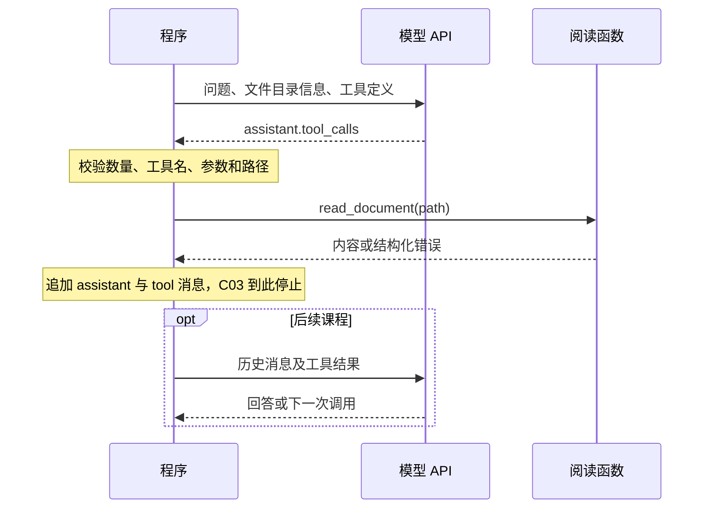

# C03：工具调用与执行边界

本讲承接 [C02 模型交互](C02-model-interaction.md)。C02 把模型文本解析成业务数据；C03 引入工具调用（tool calling），把模型提出的行动解析成参数，由程序判断是否允许并执行。核心问题是：**模型说要读取文件，到文件内容真正进入下一次输入，中间发生了什么？**

继续使用 C01 的虚构 Markdown 资料。这次先给模型文件目录，让它提出阅读请求。你要实现的阅读工具负责把请求变成受约束的文件操作，并把结果整理成后续模型能接收的消息。

## 前置知识与验收目标

需要会使用 Python 函数、字典、JSON、异常和基本文件读取，理解 C02 中“能解析不等于符合契约”。不要求掌握 SDK、MCP、操作系统沙箱或模型训练。

本课先解释请求与执行的分工，再看参数、结果如何对应，最后把阅读范围落实到代码。完成后应能沿一条消息指出：这是模型提出的动作，这是程序实际执行的动作，这是准备回传的结果。

完成标准：

1. 沿消息和代码解释工具定义、调用请求、实际执行、结果回传的分工。
2. 实现限定资料目录的阅读函数，正常读取返回全文与来源；非法参数、越界路径和超大文件被拒绝。
3. 展示一次调用及匹配的工具结果；能解释未知工具、缺失调用 ID、批量请求分别如何处理。
4. 比较含糊与清晰的工具描述，区分接口描述、程序强制约束与模型实际使用效果。

## 第一段：工具调用首先是一条模型输出

C01/C02 的程序预先读取三份全文，模型只能处理已经送入上下文的内容。C03 的第一次请求只提供文件目录信息、问题和工具定义；模型若需要原文，可以请求 `read_document`。返回的函数名和参数仍是数据，必须经过程序才会影响环境。

例如模型返回“工具名 read_document，参数 path=limits.md”。这相当于把一个操作请求交给应用，Python 不会因为看见这个名字就自动调用函数。**分发器（dispatcher）**是应用中的一段代码：它从明确允许的工具里找到对应实现，完成必要检查，再把参数交给函数。调用名不在允许列表里，就应拒绝，而不是把模型文本当作任意代码运行。

这样分工是为了让模型按需要选择动作，同时由程序决定哪些动作可以产生实际影响。模型描述“我读完了”不能替代执行结果；同样，程序成功读取也不表示下一次模型请求已经带上了全文。

| 环节 | 谁负责 | 本课中的具体内容 |
| --- | --- | --- |
| 定义可用能力 | 程序开发者 | 公开一个 read_document 工具、参数 Schema 与使用说明。 |
| 提出调用 | 模型 | 输出工具名、arguments 和调用标识；也可能没有调用。 |
| 校验并分发 | 程序 | 检查调用数量、工具白名单、参数类型及路径范围。 |
| 实际读取 | Python 函数与操作系统 | 在程序权限内打开文件，得到内容或错误。 |
| 组织后续输入 | 程序 | 保留 assistant 调用消息，再追加与其 ID 对应的 tool 结果。 |
| 根据结果继续 | 下一次模型调用 | 读取新输入后回答或提出后续行动；循环在 C04 实现。 |

本课所用 DeepSeek 接口把调用放在 assistant 的 `tool_calls` 字段，应用自己实现函数。具体字段依据见 [官方 Tool Calls 示例](https://api-docs.deepseek.com/guides/tool_calls/)。其他接口可能使用不同字段名，职责划分仍需逐项核对。



检查问题：只把 Python 函数写好却不把定义传入请求，模型如何知道接口？只收到 `tool_calls` 却不运行分发器，文件会被读取吗？给函数起名 `read_document` 本身会限制它的权限吗？

## 第二段：描述给模型看，约束由程序落实

工具定义（tool definition）包括工具名、描述和参数的 JSON Schema。这里的**模式（schema）**描述参数应有哪些字段、字段是什么类型。例如要求 path 是字符串，只能回答“这个参数长什么样”；它没有实现读取，更没有证明字符串指向允许的文件。下面是教学接口示意，完整定义见 [实验骨架](../labs/C03-tool-calling/read_tool.py)：

```json
{
  "type": "function",
  "function": {
    "name": "read_document",
    "description": "Read one UTF-8 Markdown document from the course catalog.",
    "parameters": {
      "type": "object",
      "properties": {"path": {"type": "string"}},
      "required": ["path"],
      "additionalProperties": false
    }
  }
}
```

`{"path":"limits.md"}` 与 `{"path":"../outside.md"}` 都可能符合这个参数形状，但权限判断不同。模型遵守 Schema，也不能替程序证明目标文件在允许范围内。这里采用普通工具模式；DeepSeek 另有 Beta strict 模式，启用条件和支持范围见 [官方说明](https://api-docs.deepseek.com/guides/tool_calls/#strict-mode-beta)。本课不把严格格式生成视作文件权限保证。

描述与校验也有不同职责。清楚的描述能告诉模型什么时候适合使用工具、该填什么参数；程序检查则决定收到请求后是否真的执行。即使当前模型从未尝试越界，路径校验也必须能独立拒绝非法输入。

同一个实现可以配两种描述：

- 含糊：只说“Read a file”。
- 清晰：说明何时使用、接受资料目录内的相对路径、返回哪些字段、拒绝哪些输入，以及单次读取大小限制。

先比较信息差异，再保持问题、工具名、Schema、实现、模型配置不变，仅改变 description 观察调用选择和参数。这个比较方式受 [R004 工具设计文章](https://www.anthropic.com/research/writing-tools-for-agents) 启发；是否有效由当前实验检验。一次成功或失败都不能证明普遍规律，也不要把模型“没尝试越界”当作程序会拒绝越界的证据。

本课默认 `tool_choice="auto"`，允许模型直接输出文本；即使提示词要求调用，也要检查实际响应。没有调用时记录“未产生本课需要的调用”，不伪造一次调用接着执行。当前参数含义见 [Chat Completions 文档](https://api-docs.deepseek.com/api/create-chat-completion/)。

## 第三段：arguments、返回值和消息关联

C02 已经区分过“JSON 外壳”和“其中的文本”。这里再次出现同样的层次：模型回复里有一个工具调用对象，但其中的 arguments 仍是一段 JSON 字符串。程序必须先把它解析成对象，再检查参数含义。

以下是**人工构造、未发送给 API** 的消息片段。它只用来说明协议，并不代表模型实际调用过工具：

```json
{
  "role": "assistant",
  "content": null,
  "tool_calls": [{
    "id": "call_demo_01",
    "type": "function",
    "function": {
      "name": "read_document",
      "arguments": "{\"path\":\"limits.md\"}"
    }
  }]
}
```

`function.arguments` 是 JSON 字符串。程序先 `json.loads`，再检查对象恰好只有 path、值为非空字符串且不含 NUL；随后进行路径校验。分发器只允许调用明确列出的函数，不使用 `eval`、任意函数查找或 shell 执行模型文本。

成功结果在本课中的业务结构是 `{"ok": true, "file": "limits.md", "content": "文件全文"}`。程序将其序列化为字符串，放入下面的 tool 消息：

```python
tool_message = {
    "role": "tool",
    "tool_call_id": call["id"],
    "content": json.dumps(result, ensure_ascii=False),
}
next_messages = previous_messages + [assistant_message, tool_message]
```

ID 把结果对应到具体请求；不能凭工具名猜测它属于哪次调用。例如在后续的多轮任务中，同一个 read_document 可能先读规则、再读记录，工具名相同，返回内容却属于不同请求。tool_call_id 让应用可以核对这份结果对应哪一次调用。

函数报错但有有效调用 ID 时，也可以返回对应的结构化错误，例如 `ok=false`、`error.code="not_found"`。“调用信封”指包裹参数的 ID、类型和工具名等字段；缺少 ID 或这些字段损坏时停止处理并保留响应，不能虚构一个 ID 冒充完整关联。

C03 程序只接受恰好一个调用；若一次出现两个，**在执行任何一个之前拒绝本轮**。这是课程程序的限制，和虚构 limits.md 里“最多三次”是两回事。下一次模型请求尚未发生，因此此时只有工具执行结果，没有基于新结果生成的最终答案。

### 候选回复数量与工具调用数量

外层 `choices` 表示候选回复（completion choices）；每个候选的 `message.tool_calls` 才是该回复提出的工具调用列表。它们位于不同层级，不能用 `len(choices)` 代替调用次数。字段结构依据见 [DeepSeek 响应定义](https://api-docs.deepseek.com/api/create-chat-completion/)，本课使用非流式响应。

```plaintext
response
└── choices                    候选回复列表
    └── choices[0]
        ├── finish_reason      该候选的结束原因
        └── message
            └── tool_calls     该回复提出的工具调用列表
```

以下是人工构造的协议检查情形，不是模型实际运行记录：

| 情形 | 本课检查的位置 | 是否进入分发器 |
| --- | --- | --- |
| 两个 choices，各含一个合法调用 | 候选回复数量检查，要求恰好一个 choice。 | 否。不能将候选回复拼成两步执行。 |
| 一个 choice，含两个合法调用 | 该候选的 message.tool_calls 数量检查，要求恰好一个调用。 | 否。不能先执行第一个再拒绝第二个。 |
| 一个 choice，含一个合法调用 | 先核对候选、结束原因及 assistant 消息，再核对 tool_calls 数量。 | 可进入；调用信封、工具名、参数和路径仍须校验，数量合格不保证读取成功。 |

`finish_reason="tool_calls"` 表示模型生成了调用请求，不能证明 Python 已经执行工具。实际执行了几次，需要查看程序经过的分支与执行记录。C04 的跨轮计数也必须由程序维护，不能从本次 `choices` 长度推算。

## 第四段：把阅读范围变成可检验约束

为什么要限制路径？模型输出的参数可以是任何字符串，而应用只打算开放指定目录的 Markdown 文件。**资料根目录**是允许读取范围的起点，由程序固定；模型只能提供相对于它的路径，不能自行改变这个起点。

还要区分路径文字和实际目标。`..` 表示上一级目录，符号链接则可能让一个看似在目录内的名字指向外部文件。如果只检查字符串是不是以 `docs` 开头，旁边的 `docs-backup` 也可能被错误接受。先解析实际目标，再判断目录包含关系，才能验证这里需要的边界。

阅读契约如下。每一行都给出输入条件和预期行为，供你实现函数后用正常及非法输入核对：

| 要检查的条件 | 本课行为 | 反例或边界 |
| --- | --- | --- |
| 参数与调用名 | 未知工具、缺字段、错类型、额外参数、空白或 NUL 被拒绝。 | 模型不能添加 root 参数来扩大范围。 |
| 路径表达 | 拒绝绝对路径及任何 `..` 分量，包括最终仍落在目录内的路径。 | `nested/../limits.md` 也拒绝；这是明确的简化策略。 |
| 实际目标 | 解析路径和符号链接后，目标必须在解析后的根目录内。 | `docs-backup` 与 `docs` 共享文本前缀，不代表包含关系。 |
| 文件种类 | 目标存在，是普通文件，规范化目标的后缀为 `.md`。 | 文件夹叫 `directory.md` 仍不是可读文档。 |
| 读取规模与编码 | UTF-8；最多 4096 字节。超限或编码错误返回错误，不返回半份全文。 | 汉字的字节数不等于字符数；刚好 4096 字节允许。 |
| 结果与错误 | 返回相对文件名和全文，或固定错误码及说明。 | 不把主机绝对路径、系统异常详情混入对模型的错误消息。 |

Python 的 `resolve()` 可解析符号链接，`is_relative_to()` 自身只做路径关系判断；相关 API 依据见 [pathlib 文档](https://docs.python.org/3.12/library/pathlib.html#pathlib.Path.resolve)。实现时先明确规范化与校验顺序，再测试目录外符号链接。大小限制需要有界读取，不能先把任意大文件全部读进内存再截取。

实验假设资料目录由课程维护且读取期间不被并发修改。路径检查与打开文件之间仍有时间间隔；本课实现不是抵御恶意并发替换的完整沙箱。C09 再讨论更强执行边界。文件中的文字属于待处理资料，即使它要求“忽略规则”，也不改变程序的路径或调用数量限制。

## 实验与复盘

实验要验证“请求是否合法”与“动作是否执行”之间的边界。进入 [C03 实验说明](../labs/C03-tool-calling/README.md)，在本地副本完成 `resolve_document` 和 `read_document`；工具定义、分发器、消息关联与请求代码已经提供。

| 实验动作 | 要观察的结果 | 对应知识点 |
| --- | --- | --- |
| 用目录内文件测试阅读函数 | 内容完整，来源是规范化后的相对文件名 | 合法参数如何变成实际读取 |
| 用越界路径、错误参数和过大文件测试 | 在相应层拒绝，不返回外部或部分全文 | 描述与程序强制边界的区别 |
| 使用模拟调用构造后续消息 | 调用 ID 与结果对应，结果内容可以解析 | 参数、函数返回值与 tool 消息的接线 |
| 接口可用时观察实际请求 | 模型是否提出调用、参数是什么、工具是否成功 | 模型选择与离线函数行为分别验证 |

先运行离线验收和模拟调用，再在接口可用时观察一次真实工具请求。每条 `--send` 只请求模型一次、最多执行一个阅读工具，不自动重试、不发第二轮。课堂优先完成最小正常路径与拒绝路径；描述对照可先做静态比较，有余量再按限定预算实测。无真实接口时明确记录真实模型行为未验证。

按 [C03 验收参考](../evals/C03-tool-calling-cases.md) 分别记录函数行为、协议关联和模型选择。工具读到了正确原文，仍不等于模型下一次回答正确；工具失败也不能自动翻译成 C02 的“资料不足”。错误要作为错误保留，后续是否重试、改参数、换工具或结束，需要另外设计控制逻辑。

最后解释这条链路：**工具定义 → 模型调用请求 → 程序校验 → 实际读取 → 对应结果消息**。指出每个箭头由谁驱动，并说明接上 C04 的循环后，哪些选择可交给模型、哪些限制仍必须由程序执行。按实验说明保存本地实现与记录。

复盘描述对照时，若两种描述得到相同的合法调用，只能记录当前条件下未观察到调用差异。工具名、参数说明、文件目录备注和 system 指令仍提供信息；不移除或改变这些条件做进一步实验，就不能确定哪一条线索起了作用。保留请求中的其他条件和响应用量，分别讨论行为、输入长度与未测量的费用或延迟；不要用一次用量差异代替效果结论。

## 引用

以下来源在 **2026-10-24** 备课时核对；**2026-10-25** 补核 R047 的非流式响应层级与结束原因。编号见 [资源索引](../resources/index.md#c03-工具调用参考)。引用说明讲义的依据；不把来源示例或离线夹具当作本项目真实运行证据。

**2026-10-26** 改写时补核 R047 的工具消息与响应字段、R053 的路径关系与符号链接行为。范围见 [机制复核记录](../resources/index.md#c01c04-讲义改写的机制复核)。

| 来源 | 本讲使用的内容与查阅范围 | 边界 |
| --- | --- | --- |
| **R047 — DeepSeek**：[Tool Calls](https://api-docs.deepseek.com/guides/tool_calls/)、[Chat Completions](https://api-docs.deepseek.com/api/create-chat-completion/)。持续更新，统一发布日期未知。 | 已选读非思考模式示例、工具与结果字段、tool_choice、结束原因和 strict 模式说明；补核 choices 与 message.tool_calls 的响应层级，作为本实验接口依据。 | 普通模式与 Beta 模式有别；文档示例不代替本地实现和真实接线验证。模型标识和支持参数需在运行时复核。 |
| **R004 — Ken Aizawa / Anthropic**：[Writing effective tools for agents — with agents](https://www.anthropic.com/research/writing-tools-for-agents)，2025-09-11。 | 已选读 What is a tool、Building a prototype、Running an evaluation、Returning meaningful context、Prompt-engineering your tool descriptions。支持接口描述和执行效果分别检查。 | 原文经验不等于当前模型上的保证；本课没有复现其评测或优化过程。 |
| **R053 — Python**：[pathlib](https://docs.python.org/3.12/library/pathlib.html)，3.12 文档分支，统一发布日期未知。 | 已选读 is_absolute、is_relative_to、resolve、exists、is_file，核对路径运算与文件系统查询的区别。 | API 行为不是完整安全设计；本课仅验证静态课堂目录中的读取边界。 |
| **R032 — Timo Schick 等**：[Toolformer](https://arxiv.org/abs/2302.04761v1)，2023-02-09，v1。 | 仅复核摘要与元数据，用作“学习何时调用工具”这一训练问题的背景入口。 | 本课给已有模型提供工具定义与执行器，不更新权重；未精读正文或复现实验。 |

单工具限制、4096 字节上限、错误结构、两处练习及评分标准均由本课程设计，不是服务接口自带的权限保证。

## 深入阅读

以下均为可选，选一项即可；时间为选段阅读与思考的估计，不增加主线必修学时。

| 想继续追问的问题 | 建议范围与阅读产出 | 预计时间 |
| --- | --- | --- |
| 一次工具调用为什么通常还要有后续模型请求？ | **R047**：[Tool Calls 的 Non-Thinking Mode 示例](https://api-docs.deepseek.com/guides/tool_calls/)。在示例中标出两次请求、函数执行位置和消息追加顺序，对照本实验停止的位置。 | 5–10 分钟 |
| 一个回复能提出几个调用，在哪里检查？ | **R047**：[Chat Completions 的非流式 Responses](https://api-docs.deepseek.com/api/create-chat-completion/)。定位 choices、message.tool_calls 和 finish_reason，再对照本课两个数量限制，区分接口字段与应用自行设置的限制。 | 5–10 分钟 |
| 清晰的描述究竟改善哪一层？ | **R004**：[工具设计文章](https://www.anthropic.com/research/writing-tools-for-agents) 的 Prompt-engineering your tool descriptions 与 Running an evaluation。列出保持不变的条件、要观察的调用错误与任务结果，避免只以一句回答是否顺眼评分。 | 10–15 分钟 |
| 路径看起来位于目录内，为何仍可能越界？ | **R053**：[is_relative_to](https://docs.python.org/3.12/library/pathlib.html#pathlib.PurePath.is_relative_to)、[resolve](https://docs.python.org/3.12/library/pathlib.html#pathlib.Path.resolve)。对照临时目录中的符号链接案例，分别预测解析前后的目标。 | 10–15 分钟 |
| 模型的工具能力从哪里来？ | **R032**：[Toolformer 摘要](https://arxiv.org/abs/2302.04761v1)。区分训练出调用能力、推理时提供工具描述、应用执行函数三件事；全文方法与复现留到可选 P02。 | 5–10 分钟 |

已有 [CMU 课程导读](../resources/R046-cmu-ai-agents.md) 也包含工具使用讲义与作业入口。需要对照完整执行循环时再随 C04 选读，不要求提前完成整套外部作业。
