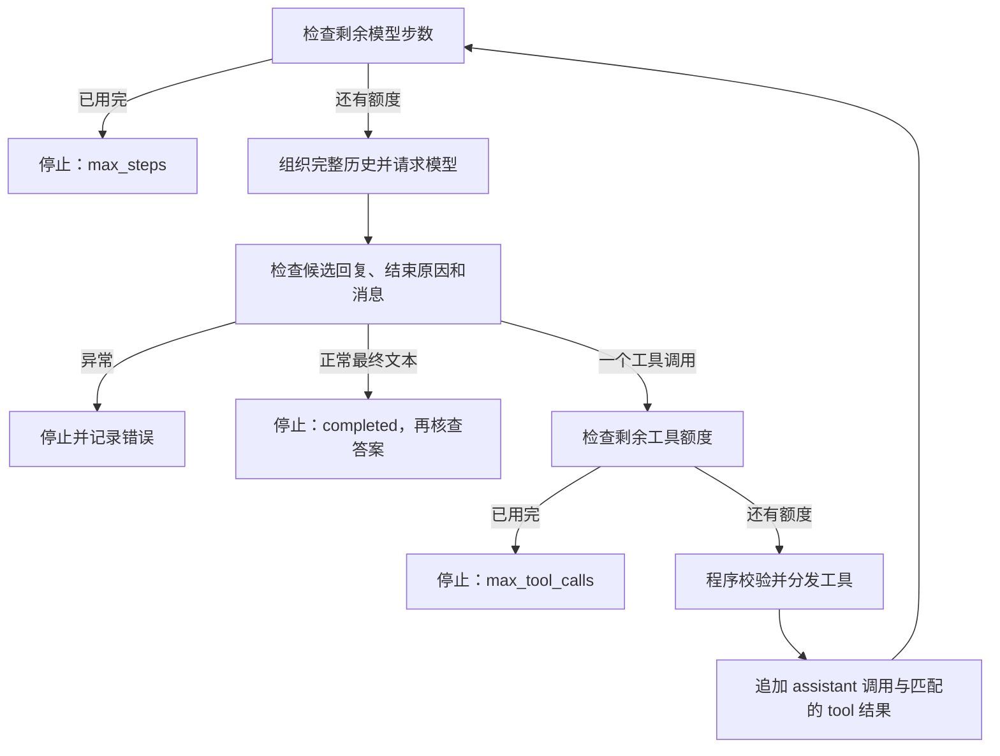

# C04：Agent 循环与停止条件

本讲承接 [C03 工具调用](C03-tool-calling.md)。C03 已把一次工具结果放进 next_messages；C04 要把这些消息发送给模型，让它依据结果选择下一步，并让程序保证运行在设定的次数内停止。

这是可预读的公共课程材料，配套 [实验骨架](../labs/C04-agent-loop/README.md) 与 [验收参考](../evals/C04-agent-loop-cases.md)。准备好材料不代表已完成学习或验证真实模型效果。

## 问题、前置知识与验收目标

核心问题：**文件读完后，谁决定继续读什么、何时回答，谁负责在模型持续请求工具时停止？**

前置：能解释 C03 中的 assistant/tool 消息、调用 ID、候选回复与工具调用的层级；会使用 Python 循环、条件和函数，知道工具可能返回错误。已有 C03 实现可以复用，不重新写路径工具。

建议 60 分钟：5 分钟回顾消息边界，15 分钟原理与轨迹预测，30 分钟实现和验证，10 分钟验收复盘。模拟轨迹足以检查控制逻辑；接口可用且预算允许时，再运行一次真实任务。深入阅读不计入必修时间。

完成标准：

1. 实现“请求模型 → 检查响应 → 执行工具 → 加入反馈 → 再请求”的循环，并保留完整消息。
2. 分别限制模型请求次数和工具分发次数，解释计数时机及边界，不多发一次请求来补总结。
3. 展示正常回答、步数耗尽、工具额度耗尽三种停止路径；能从记录核对停止原因和实际次数。
4. 说明工具反馈如何进入下一轮，以及运行结束为什么不等于任务答案正确。

## 第一段：循环固定，行动选择可以变化

程序规定每一步必须经过哪些检查，模型在可用工具和预算内选择行动。循环代码可以固定为同一个函数，但每次选择的文件、调用次数和结束时机可以不同。是否采用 Agent 不能只看代码里有没有 while：固定“读 A → 读 B → 回答”的流程也可以写成循环。

C04 的问题仍是“根据现有记录，T01 是否已经达到工具调用上限？”第一次输入只给文件名、主题和问题，没有全文。一种可能路径是先读 trace.md，看到任务记录后再读 limits.md，最后结合两者回答；先读 limits.md 也可能成立。程序不把文件顺序和标准答案写进循环。

这里的 Agent 循环（agent loop）使用环境反馈（environment feedback）继续决策。模型提出行动；程序控制可执行能力、运行上限和结束状态。这与 [R003 对 Agent 的说明](https://www.anthropic.com/research/building-effective-agents) 相呼应，但具体检查和计数口径由本课程设计。

## 第二段：让反馈真正进入下一次输入

在本课使用的 Chat Completions 接口中，程序必须显式传递历史。工具结果只写到文件、打印到终端，或者只保存在一个没有放进请求的变量里，都不能让下一次模型调用看到它。官方消息接线示例见 [DeepSeek Tool Calls](https://api-docs.deepseek.com/guides/tool_calls/)。

下面是一条**人工设计的可能轨迹**，不是模型实测，也不是程序必须遵守的固定路径：

| 请求序号 | 本次输入在原有 system、user 后新增的内容 | 模型可能输出 | 程序处理 |
| --- | --- | --- | --- |
| 1 | 无 | 请求读 trace.md | 检查、执行，追加 assistant 与 tool。 |
| 2 | 请求 1 的调用及其结果 | 请求读 limits.md | 检查、执行，再追加一对消息。 |
| 3 | 前两次的全部调用及结果 | 带来源的最终答案 | 保存 assistant 最终文本并结束。 |

第三次请求必须包含两次工具交互，不能只保留最近一个 tool 消息。每条结果的 tool_call_id 对应提出该调用的 ID，文件名相同也不能混淆不同调用。本课保留完整历史；裁剪和摘要留到 C05。

检查问题：把第二次读取成功的消息加入列表之后，是否已经有最终答案？如果下一轮只发送“继续”，程序之前的读取证据会自动加入吗？

### 与 ReAct 的关系

[ReAct §2](https://arxiv.org/html/2210.03629v3#S2) 讨论把推理、行动和环境观察交替组织，使后续行为利用已有反馈。本课借用“行动得到观察，观察参与下一步”的机制直觉，使用现代工具调用字段实现控制流。实验不要求输出隐藏思考过程，也不把日志中的解释当作真实执行证据；只记录可观察的请求、调用、结果与状态。

这不是原论文复现，也不意味着加上循环必然提高答案质量。论文的任务、模型、提示与对比条件不同；本课仍保留 C01 的单次全文输入基线，是否值得增加模型调用要在后续同口径评测中判断。

## 第三段：先定义“一步”，再写上限

本课定义一次 step 为**一次模型请求尝试**；不论返回最终文本、工具调用还是网络错误，都消耗一个模型步骤。一轮用户任务可以包含多个 step。不同框架中的 turn、step 定义可能不同，阅读时应查具体实现。

| 状态 | 本课含义与更新位置 | 为什么这样计数 |
| --- | --- | --- |
| model_calls | 发起模型请求前加 1。 | 请求可能超时，不能因没有可用答案就当作没尝试。 |
| tool_calls | 进入工具分发器前加 1；返回 ok=false 也消耗额度。 | 非法参数和工具错误不能成为无限尝试的出口。 |
| max_steps | 默认 4，发请求前检查。 | 限制本任务最多尝试几次模型调用。 |
| max_tool_calls | 默认 3，执行工具前检查。 | 限制最多进入几次分发器，不是成功读到文件的次数。 |

两个计数初始均为 0。工具调用请求与实际分发仍是两件事：模型提出一次调用，但程序因额度不足拒绝，tool_calls 不增加；原始响应仍保留在轨迹中。未知工具被分发器拒绝时，消耗一次分发尝试，但实际阅读函数执行 0 次。

这些是**运行程序的真实预算**。limits.md 中的“三次”是虚构资料里的任务规则，trace.md 中的 T01 也不是当前脚本的执行记录。即使恰好使用相同数字，资料文本也不能修改程序的计数器。

### 边界情况要先预测

| 条件与下一步 | 本课应如何处理 |
| --- | --- |
| max_steps=0 | 不请求模型，直接 max_steps。 |
| 已用完工具额度，但模型步数还有余额 | 允许请求模型；若它正常回答，可以 completed；若又请求工具，在执行前 max_tool_calls。 |
| 最后一个允许的模型请求返回最终文本 | 正常完成，不因计数恰好等于上限而丢弃答案。 |
| 最后一个允许的模型请求要求工具，工具额度仍足够 | 执行并保存结果，随后以 max_steps 停止；没有新生成的最终答案。 |
| 模型反复请求同一文件 | 每次请求和分发照常计数；必须由程序上限结束，不能只靠提示词劝停。 |

本课不在达到上限后“再请求一次总结”，因为那会突破声明的上限。也不把“已读到一些文件”自动补成业务答案。最大步数不是精确费用、总耗时或上下文长度限制；每轮历史继续增长，真实花费要结合每次 usage 和当时计费规则判断。

## 第四段：正常结束、受限停止与错误分开记录

| status | 触发条件 | 是否有已接受的最终答案 |
| --- | --- | --- |
| completed | finish_reason=stop，文本非空且没有工具调用。 | 有，但事实、引用和完整性仍待评分。 |
| max_steps | 下一次模型请求前发现额度用完。 | 无，不自动生成替代答案。 |
| max_tool_calls | 模型要求继续执行工具，但分发额度已用完。 | 无，保存被拒绝的原始调用请求。 |
| protocol_error | 候选数量、调用数量、结束状态、ID 或结果结构不符合本课约定。 | 无，保留可解析的原始响应。 |
| model_error | 请求或外层响应解析失败。 | 无，不自动重试。 |
| tool_exception | 工具执行器抛出未转成业务结果的预期异常。 | 无，已尝试次数保留。 |

普通 `ok=false` 工具结果属于可回传的反馈，不直接结束任务：模型可能调整参数、请求其他文件或说明无法继续。这些后续动作仍受原预算限制。不要把工具执行失败自动转换为“资料没有答案”；模型还没有取得资料与资料本身不包含答案，是不同状态。

本课仍只接受一个候选回复中的一个工具调用；不加入并行工具批次。`finish_reason=length` 不能当作最终回答，也不能把截断的参数直接执行。若工具结果的 ID 对不上，程序停止，不将其接入下一轮。自动重试与更完整的故障恢复留到 C09。

## 第五段：用轨迹验证循环

执行轨迹（execution trace）至少应回答：每轮实际发送了哪些消息、模型返回了什么、工具是否进入分发器、返回什么、计数如何变化、最后为什么停止。保留请求快照，避免把同一个可变列表的最终内容误记成所有轮次的输入。

实验提供 Session 辅助类，负责请求、分发、计数、消息配对和记录；你实现 `run_loop` 决定何时调用这些方法、何时退出。Session 的计数方法不会代替你检查预算，也不要在循环里重复自增计数。

先预测 [离线案例](../evals/C04-agent-loop-cases.md) 的最终状态和两种次数，再运行。模拟模型可固定输出，也可读取上一轮工具结果来选择后续路径；这能验证反馈是否被传递，但不能证明真实模型一定正确利用反馈。

真实任务沿用 E02，程序初始化时不读全文。最多进行一次任务运行，单任务默认最多 4 次模型请求、3 次工具分发。检查最后答案是否正确结合 limits.md 与 trace.md，并提供文件名和支持结论的原文。若提前结束、撞上限制或答错，如实保存，不为得到理想结果反复运行。

### 收尾检查

1. 对一条正常轨迹标出程序控制与模型选择，解释新证据如何进入下一次请求。
2. 对持续请求工具的模拟轨迹，指出哪一行阻止额外请求或执行。
3. 分别解释“工具额度用完后正常回答”和“最后一步刚拿到工具结果”的结果为何不同。
4. 区分控制流通过、模型完成生成、业务验收通过三种结论；与 C01 基线的效果比较尚未完成。

个人实现放在 `*.local.py`，日志和评分放在 `.local/`。本讲不新增长期记忆、规划器、检索工具、并发或模型训练；后续课程逐项说明引入它们解决什么问题。

## 引用

以下选段于 **2026-10-25** 备课时核对；稳定编号及更新范围见 [资源索引](../resources/index.md#c04-agent-循环参考)。课程的状态名、预算口径、工具限制和验收用例由本课程设计。

| 来源 | 使用范围 | 证据边界 |
| --- | --- | --- |
| **R047 — DeepSeek**：[Tool Calls](https://api-docs.deepseek.com/guides/tool_calls/)、[Chat Completions](https://api-docs.deepseek.com/api/create-chat-completion/)。持续更新，统一发布日期未知。 | 复核非思考工具调用示例、assistant/tool 消息接线；响应层级与结束原因沿用 C03 当日核对结果。 | 规定接口字段，不替应用实现循环、权限或任务评分；模型与参数需在实际运行时复核。 |
| **R003 — Anthropic**：[Building effective agents](https://www.anthropic.com/research/building-effective-agents)，2024-12-19。 | 选读 What are agents、Agents：动态选择、环境反馈与停止条件。 | 页面已提示工具生态变化；本课使用架构观点，不照搬旧工具配置或性能结论。 |
| **R031 — Shunyu Yao 等**：[ReAct](https://arxiv.org/html/2210.03629v3)，首次公开 2022-10-06，v3 为 2023-03-10。 | 选读 §2、§3.1–§3.3 及表 1、表 2，了解行动—观察机制、对比方法与失败分类；课内只讲反馈机制。 | 未全文精读、训练或复现原实验，不把原论文结果外推为本项目改进。 |
| **R030 — DeepSeek Harness**：[agent-loop README](https://github.com/deepseek-ai/deepseek-harness/blob/639ed015397290b3745d163aafe02ffee4aa3f84/packages/core/agent-loop/README.md)，固定 commit `639ed015397290b3745d163aafe02ffee4aa3f84`。 | 补读 Summary、What a step does、Source map、Turn and step flow，作为最小实现之后的源码阅读入口。 | 这是较复杂的 TypeScript/Cordis 实现；本次未新增源码审计或运行框架。并发工具数量与本课总请求上限不是同一口径。 |

## 深入阅读

以下均为可选，不增加主线必修学时。按疑问选一项；预计时间只覆盖所列片段。

| 想继续追问的问题 | 建议范围与可验证产出 | 预计时间 |
| --- | --- | --- |
| 工具结果什么时候才被模型看见？ | **R047**：[Tool Calls 的非思考示例](https://api-docs.deepseek.com/guides/tool_calls/)。标出第一次请求、实际函数实现位置、结果追加和第二次请求；对照本课 messages 的变化。 | 5–10 分钟 |
| 为什么固定循环还可以承载动态策略？ | **R003**：[What are agents 与 Agents](https://www.anthropic.com/research/building-effective-agents)。分别列出程序固定的检查与模型可选择的行动；用同一工具集构造一条固定流程和一条反馈循环。 | 10–15 分钟 |
| ReAct 的反馈机制是什么，它比较了什么？ | **R031**：[§2](https://arxiv.org/html/2210.03629v3#S2) 与 §3.2–§3.3。区分 Standard、CoT、Act、ReAct 的信息来源；再从表 2 找一个即使有工具仍可能失败的原因。无需训练或复现论文。 | 15–20 分钟 |
| 真实框架把 turn、step、工具执行放在哪里？ | **R030**：[agent-loop README](https://github.com/deepseek-ai/deepseek-harness/blob/639ed015397290b3745d163aafe02ffee4aa3f84/packages/core/agent-loop/README.md) 的 What a step does、Source map、Turn and step flow；结合 [源码导读](../resources/R030-deepseek-harness.md)。先画模块分工，再按需进入源码；不要求安装 DSH。 | 15–20 分钟 |

完整论文分析继续使用 [P01 精讲路线](../papers/index.md)，它是另行安排的可选课程。本课的模拟轨迹与离线测试是机制检查，不是原论文复现或真实模型成功率评测。
