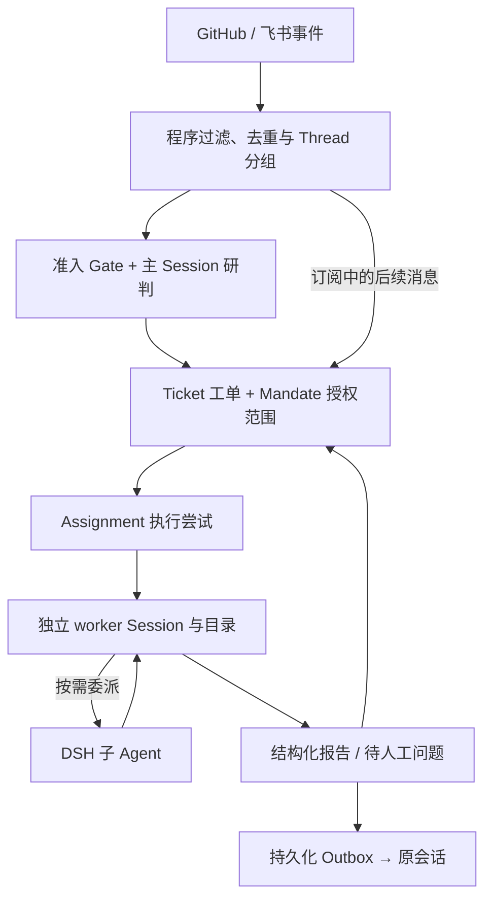

# 单 Agent、固定多 Agent 工作流与动态主从：成本—质量证据综述

> **审校版说明（2026-11-01）：** 以 `agent-survey.md` 为底稿，保留其论述、数字和结构，在相关位置添加“更正、限定、待核”标注。原句与更正标注冲突时，以标注为准；“待核”数字不作为已验证结论。底稿所述的全文与代码核查是底稿的阅读声明，本轮仅完成下文注明的抽查，未重新运行模型实验。资源版本、查阅状态和课程映射见[资源索引](index.md#agent-orchestration-records)。

**检索截止：2026-10-30。** 本文回答的是同一工作流或任务上的架构选择，而不是比较不同模型的绝对能力。结论先行：

- **默认先用单 Agent**：任务强顺序依赖、需要连续全局上下文、单 Agent 已达到质量要求，或任务价值不足以支付协调开销时，增加 Agent 通常不划算。
- **子任务及接口稳定时，优先固定工作流**：它能把已知分解、验证门和并行分支写进程序；若节点只是单次 LLM 调用，应称“固定多 LLM 工作流”，不必伪装成多 Agent。
- **只有运行时才能确定子任务，且并行、上下文隔离或专有能力带来的收益超过协调成本时，才采用动态主从**。开放式广度搜索是较强适用例；紧密耦合、要求统一隐含决策的任务是较强反例。
- **不存在证据支持的跨任务统一排名**。本次非穷尽检索找到两项同研究三臂系统对照，但并非每个节点都满足严格 Agent 定义：医学决策中的 KAMAC 和二分类预测中的 *Allocation, Not Volume*；其余主要是两方对照、消融或生产经验。两个领域不足以排出“单 Agent < 固定多 Agent < 动态主从”之类的通用排行榜，也不能跨论文拼接排名。

> **审校 01｜限定选型建议：** 前三条是待验证的工程建议。“只有运行时才能确定子任务”不是动态委派的必要条件：子任务类型已知时，也可能需要根据反馈调整实例数、顺序或停止时机。上下文隔离、专有工具和并行本身也可由固定流程实现。应比较动态决策相对固定流程新增的收益；单 Agent 同样不保证成本更低或更稳定。第 7 节的条件也按此理解。

本文核对了公开正文、实验表格、附录和部分作者代码，**没有实际复现或重跑实验**。所有相对变化均注明是百分比还是百分点；自行计算的比例给出算法。

## 1. 检索与证据分层

检索渠道包括 arXiv、OpenReview、ACL Anthology、团队官方工程博客、作者项目页与代码库，并从核心论文的参考文献和后续引用反向追踪。主要检索词为：

- `single-agent multi-agent equal thinking token budget`
- `single agent fixed workflow multi-agent token cost accuracy`
- `orchestrator worker single agent cost quality`
- `dynamic subagent delegation benchmark`
- `static versus dynamic agentic workflow`
- `multi-agent debate controlled cost latency`

重点阅读方法、实验设置、结果表、附录与局限；用作者代码核对实际控制流。只见到摘要或二手转述的资料不支撑关键结论。检索不是系统综述意义上的穷尽搜索，也未对所有候选论文做元分析。

证据按比较范围分层：

1. **Ⅰ级：同一研究直接覆盖三类配置**，且有共同任务、模型或工具栈。覆盖范围不等于结论具有普遍性。
2. **Ⅱ级：只直接比较两类**，或虽出现三类但预算、工具、搜索成本等未完全对齐。
3. **Ⅲ级：消融、故障分析、生产经验或其他间接证据**。

> **审校 02｜更正证据分级：** Ⅰ/Ⅱ/Ⅲ保留为底稿的检索标签，不表示证据强弱顺序；原定义把覆盖范围与控制质量混在一起，存在重叠。应分别记录：①三类配置、两类配置或机制分析；②任务、模型、工具、提示优化、预算控制了哪些；③来源及复核状态。严格的两组消融可能比三组系统比较更能支持因果解释。同预算质量比较与自然运行成本—质量比较都是有效问题，但回答的问题不同。

## 2. 架构定义：三个维度，不要三个标签套一切

### 2.1 先判定节点是不是 Agent

本文采用最低限度的 Agent 判定：节点能保留自身状态，并在“观察—决策—行动—接收反馈”的循环中自主选择下一步，而不是只执行一次固定提示词调用。由此：

- **单 Agent（mono agent）**：一个决策循环承担任务，可多轮调用工具、检索、执行代码或自我修正；多次工具调用不构成多 Agent。
- **固定工作流中的多个 Agent**：多个上述决策节点存在，主要顺序、分支、重试和交接规则由程序预先规定。节点可串行或并行。
- **动态主从架构**：主 Agent 根据任务和中间结果拆解、创建或调用子 Agent，决定委派、继续、停止，并整合子 Agent 结果。子 Agent 可以运行时新建，也可以从预定义池中动态调用。

多个角色名、多个 system prompt、Best-of-N、投票和多次 LLM 调用都不自动构成多 Agent。固定流水线若只有一个执行体依次扮演角色，它是“单执行体的固定流程”；它可用来研究共享上下文与 KV cache，却不能直接证明开放任务中的单 Agent 自主规划优于多 Agent。

### 2.2 路由器不等于主 Agent

- **路由器（router）**：在已知类别、模型、Agent 或预设路径间做选择，常回答“下一步走哪条已有路径”。它未必拆解任务、监督执行或汇总结果，也可以是无状态的。
- **主 Agent / orchestrator**：对任务结果负责，能生成或调整子任务，委派 worker，依据返回结果继续规划，并通常负责汇总与终止。中心节点的存在本身还不够，关键是是否拥有上述决策循环。
- **混合很常见**：固定外层流程可以内嵌动态主从；动态系统也可以先由路由器决定是否需要团队。Anthropic 对 [routing 与 orchestrator-workers](https://www.anthropic.com/research/building-effective-agents) 的区分同样是“选择已知路径”与“动态生成子任务并综合结果”。

因此，LAS 这类在既有 DAG 上选择早停、验证或修复的控制器是路由器证据，不是动态创建子 Agent 的证据。

### 2.3 必须另外记录的条件

以下维度与三种架构交叉，而非包含关系：

- **上下文**：共享完整轨迹、只传摘要、隔离窗口、外部共享记忆；隔离可降噪，也会丢失隐含决策。
- **执行**：串行、批内并行、异步并行；并行旨在缩短关键路径，不减少总工作量。
- **模型与工具**：同构或异构模型、工具种类、权限和费用是否相同。
- **停止与预算**：最大迭代、Agent 数、token/费用上限、共识或质量门、超时、重试。
- **设计与运行成本**：离线搜索、训练和验证成本是否摊入；失败运行是否计入。

> **审校 03｜限定并行机制：** “不减少总工作量”只适用于计算图与执行工作量固定的比较。并行本身不保证省 token；若同时改变早停、取消、剪枝或重复探索，总工作量可以增减，应单独归因。

## 3. 比较口径：成本、质量、延迟必须分别定义

### 3.1 token 不等于费用

一次任务的全系统输入至少包括系统提示、原任务、历史、其他 Agent 消息和工具结果；输出包括最终回答、中间推理与协调消息。建议按所有模型调用汇总：

\[
C=\sum_j\left(p^I_j I_j+p^{IC}_j I^{cached}_j+p^{CW}_j I^{cache-write}_j+p^O_j O_j\right)+C_{tools}.
\]

其中 `I`、`I_cached`、`I_cache-write`、`O` 分别是普通输入、缓存输入、缓存写入和计费输出。推理 token 若已包含在 API 的输出量中，不得重复相加；未包含时才单列。工具结果通常已成为后续调用的输入，不能再作为一项独立 token 重复计费。协调文本在生产端是输出、接收端是输入，两次资源消耗都真实存在。

还必须说明总量是否覆盖所有主/子 Agent、路由器、汇总器、在线裁判与重试，以及统计单位是**每任务、每成功任务还是每次模型调用**。尤其要区分：

\[
\text{全部运行总成本}/\text{成功任务数}
\quad\text{与}\quad
\text{仅在成功运行上计算的平均成本}.
\]

前者包含失败成本，后者通常更低。美元数字保留原研究的模型、价格与计费条件，不能用 token 数直接代替费用，也不按今天的价格重算旧实验。

> **审校 04｜限定计费口径：** 公式中的普通输入、缓存读取和缓存写入应按提供商定义互斥拆分，不能把总输入再与其缓存子集相加；推理量仅在实际另行计费且未包含于输出时单列。缺失字段应标未知。在同一批运行、成本非负且至少一次成功时，全部运行成本/成功数必然不低于成功子集平均成本；零成功时二者均无定义。

### 3.2 质量和延迟不可互换

质量按原研究定义保留：可执行测试（如 pass@1、SWE-bench）、明确规则（精确匹配、Brier score）、人工评审和模型裁判不能混成一个“准确率”。端到端延迟是墙钟关键路径；并行时应接近最慢分支加汇总时间，而不是所有调用时间之和。总模型调用、总工具调用、结果波动、失败率与恢复率另列。

> **审校 05｜更正延迟简化：** “最慢分支加汇总”只近似描述单次分叉—汇合阶段。端到端时间还包括规划、多轮委派、串行依赖、工具等待、限流、重试及集成；应从任务提交测到最终交付。Critical Steps 只能描述步骤层面的依赖长度，不能代替墙钟时间。

本文围绕两种问题分析：**同预算谁的质量更高**，以及**相近质量谁的总成本更低、关键路径更短**。若预算未控制，只讨论观察到的成本—质量帕累托关系，不作编排净效应的因果断言。

## 4. 核心证据表

“未报告”表示所核正文/附录没有可用于本文口径的数字，而不是系统没有该成本。表内美元均为原作者按当时条件报告或估算的值。

| 级别与来源（版本） | 任务与样本量 | 实际架构、上下文与执行 | 模型、工具、预算及停止 | 质量指标 | 成本与延迟口径 | 关键结果、证据位置与局限 |
|---|---|---|---|---|---|---|
| R064 · **Ⅰ** Wu 等，[*A Knowledge-driven Adaptive Collaboration of LLMs for Enhancing Medical Decision-making*（KAMAC）](https://aclanthology.org/2025.emnlp-main.1699/)，EMNLP 2025；[作者代码](https://github.com/XiaoXiao-Woo/KAMAC) | MedQA 全部 1,273 题；Progn-VQA 全部 750 对 | 单 Agent/CoT（无工具循环基线）；固定五专家独立投票（固定多 LLM）或多轮 Consensus；KAMAC 从1名专家开始，讨论中检测知识缺口并实际新增专家，主持人汇总；共享讨论历史 | GPT-4.1-mini、temperature=0，DeepSeek-R1 复验；无外部检索；最多 R=3 轮或达成共识停止 | 选择题/预后的 Acc、Prec、Spec、Recall 及四者均值，规则评分 | 附录表5给 MedQA 每例秒数、API 调用、专家数和 Cost 列；**Cost 未标货币单位**，输入/输出 token 未拆 | MedQA：单 CoT Acc/均值 **84.21/87.27**，固定投票 **86.49/89.10**，KAMAC **88.14/90.39**；时间 **9.56/39.88/10.80s**，调用 **2.20/12.02/2.55**，Cost **4.01/8.12/5.01**（表1/5）。动态方案质量更高、远低于固定团队开销，但不比单 Agent 便宜。Progn-VQA Recall **97.32→95.74**，并非所有指标都改善；显著性检验是各方法分别对单基线，不是 KAMAC 对固定方法的直接配对检验。 |
| R065（[审校 06](#review-06)）· **Ⅰ** Aboutorabi 等，[*Allocation, Not Volume*](https://openreview.net/pdf?id=VF3SHjyHB5)，Forecast@ICML 2026 Oral；[官方记录](https://icml.cc/virtual/2026/79774) | ForecastBench 228 道后截止二分类题，114/114 标签平衡 | 直接 Predictor（含 Orchestrator `D=0`）；固定深度 Predictor–Critic、固定广度 Ensemble；`D>0` 时主 Agent 运行时定义角色并委派，最后汇总 | 主扫 GPT-5.4-mini，nano 完整复扫；另三模型做检查。共享检索与污染过滤；扫描 `D/T/K/R/E` 和 ReAct 调用上限 | 已发生结果的准确率、Brier；非模型裁判 | 每题总美元含 Agent+web filter；另报 Agent-only、总 token、LLM/工具调用。输入/输出未拆，延迟未报告 | 主模型最优点：Orchestrator **80.7% / $0.175**，Ensemble **78.1% / $0.897**，Predictor–Critic **76.8% / $1.665**（表1、§3）。峰值差异的置信区间重叠，支持的是成本—质量优势而非显著准确率冠军。web filter 占总费用 **83–95%**。最佳 Ensemble 可退化为 `K=1`，不能视为纯多 Agent；单基线逐点值不在此转录。 |
| R055（[审校 07](#review-07)）· **Ⅱ** Kim 等，[*Towards a Science of Scaling Agent Systems*, arXiv v3](https://arxiv.org/abs/2512.08296v3)；[作者代码 v2.2.3](https://github.com/ybkim95/agent-scaling) | 6 个 Agent 基准、260 配置；前四项每配置 50–100 例，SWE/Terminal 各 20 例 | SAS 与 Independent、Decentralized、Centralized、Hybrid；集中式有固定 3 worker+lead，能动态分解/监督但不是运行时自由创建团队。含并行、对等辩论与共享记忆 | GPT-5、Gemini、Claude 三族；统一工具/提示，2–16 工具；匹配总推理 token（均值 4,800/试）和迭代预算 | 各任务原生成功率/正确性；WorkBench 动作匹配、Finance rubric 等，**不是同一指标** | 控制的是推理预算，不是全输入输出或美元；表5报 turns、相对开销与 trace 错误放大；墙钟延迟未报告 | Finance Centralized **0.631 vs SAS 0.349**，相对 **+80.8%**（+28.2 个百分点）；PlanCraft Independent **0.170 vs 0.568**，相对 **−70.0%**。图2、§4.1–4.4、表2/5。集中式 trace 错误放大 **4.4×**、Independent **17.2×**，但不是任务失败率。不能当作固定/动态/单 Agent 的完整三方试验；每格样本较小。 |
| R056（[审校 08](#review-08)）· **Ⅱ** Xu 等，[*Rethinking the Value of Multi-Agent Workflow*, arXiv v1](https://arxiv.org/html/2601.12307v1) | HumanEval 131、MBPP 341、GSM8K 1055、MATH 486、HotpotQA/DROP 各 800；TravelPlanner 180 | 同一 AFlow/OneFlow 固定代码工作流，分别由多个 stateless 调用执行，或由一个连续对话、共享 KV cache 的执行体扮演；主要是同构、顺序角色模拟 | GPT-4o-mini 执行，Claude-4-Sonnet 设计，20 轮优化，3 次运行；另有 Qwen3-8B/vLLM | 代码 pass@1、数学 solve rate、QA F1、规划成功率 | 表9按每次工作流拆输入/输出；表2/10给美元汇总。闭源单执行体成本是**理想 KV-cache 估算**；Qwen 实测延迟 | OneFlow GSM8K 多执行体 **93.0 / $0.623**，单执行体 **93.3 / $0.387**；输入 **1062→215**、输出 **719→557**（表1/2/9）。AFlow HotpotQA 却 **72.1→68.4**（−3.7 个百分点），说明并非处处等效。Qwen 上 OneFlow 单执行体 **4.83s vs 4.31s**，也未降低延迟。表4、A.7–A.8。证明的是固定流程的上下文/cache 效应，不是自主单 Agent 对动态主从。 |
| R057 · **Ⅱ** Tran & Kiela，[*Single-Agent LLMs Outperform…Under Equal Thinking Token Budgets*, arXiv v2](https://arxiv.org/html/2604.02460v2) | FRAMES 与 MuSiQue 4-hop；v2 实验设置未清楚列出评估 n | 单次 SAS；Sequential、Subtask-parallel、Parallel-roles、Debate、Ensemble；比较共享完整上下文与消息压缩，含并行变体 | Qwen3-30B-A3B、DeepSeek-R1-70B、Gemini 2.5；思考上限 100–10,000，规划/汇总近预算中性；主比较无外部工具 | 模型裁判按标准答案做语义正确判定 | 只控制**中间思考 token**，不含提示和最终答案；上限不等于实际消耗。全输入/输出、美元、墙钟延迟未报告 | Qwen/MuSiQue、1k 上限：SAS **0.260**、Sequential **0.229**，实际思考 token **916 vs 907**（表4），差 **3.1 个百分点**。但替换 70% 上下文 token 时 SAS **0.200**、Sequential **0.225**（表13），显示边界。§4–5、附录F/G；模型裁判、API 思考计数异常和样本未明限制外推。 |
| R066 · **Ⅱ（三类均出现但非统一受控）** Jwalapuram 等，[*The Illusion of Multi-Agent Advantage*, arXiv v2](https://arxiv.org/abs/2606.13003v2)；[项目与代码](https://multi-agent-eval.github.io/) | GPQA 166、HLE-Math 168、SWE-Lite 168、BrowseComp-Plus 268；SMFR 588（另16验证） | CoT/5 次 CoT-SC；6 种自动 MAS；人工 Expert-MAS 以 Python 固定编排，投资者维度并行，链内串行、上下文隔离 | GPT-4o、GPT-OSS、GPT-5、Gemini-2.5-Pro；自动方法各有搜索/验证预算；3 次运行，Gemini 仅1次 | 数据集准确率；SWE 隐藏测试；SMFR 程序生成标准答案 | 美元含自动 MAS 搜索与验证开销；输入/输出未拆，延迟未报告 | SMFR/GPT-5：CoT-SC **56.97 / $478.40**，固定 Expert-MAS **96.51 / $554.82**；GPT-OSS 则 **26.13 / $14.60 → 36.14 / $5.19**（表4、图4/5、附录D）。支持“明确分解+确定性控制”可奏效，也显示强模型条件。搜索成本不完全可比，不能把自动 MAS 的失败归因于所有多 Agent。 |
| R067 · **Ⅱ** Li 等，[*When Sub-Agents Work in Parallel: The Promises and Pitfalls of Dynamic Concurrency in Long-Horizon Coding Tasks*, arXiv v1](https://arxiv.org/html/2610.10263v1)；[轨迹与脚本](https://github.com/schwerli/Concurrency-Failures-Trajectory-Artifact) | 354 个任务×3 系统×2 模式=2,124 次执行；SWE-Verified 100、RepoZero 150、NL2Repo 26、ProgramBench 50、LoopsBench 28 | 同一原生 Agent 开启动态创建/委派并发子 Agent，或完全禁用并保证无子 Agent；共享工作区，含并行与结果整合 | Codex+GPT-5.4、Claude Code+Opus 5、Kimi Code+K3；同模型、提示、环境和时间预算，最高 reasoning；无固定工作流臂，无大规模重复运行 | 官方测试/任务通过率；另做执行轨迹故障标注 | 汇总 provider usage 的全 token，未拆输入/输出；时间含成功与失败任务；总记录 11.2B token，按标准 API 价 $20,780.02 | 动态/顺序的效果跨系统为 **−11.9 至 +2.3 个百分点**；token 为顺序的 **1.41–3.31×**，15 个系统×基准组合中 **14 个平均更慢**。两种模式均成功的 366 例中，动态仅 **102/366=27.9%** 更快，**46/366=12.6%** 至少快20%（表3、§4.2）。长时程互补工作、备选探索和独立验证可受益；不能外推到所有编程任务。 |
| R068（[审校 09](#review-09)）· **Ⅱ** Ding 等，[*MS-Eval*, arXiv v1](https://arxiv.org/html/2610.22869v1) | Toolathlon-Gym 166 个 MCP 密集任务；8 模型；其中 89 个标注为需要委派、77 个不需要 | SA；主 Agent 动态调用通用/专用子 Agent，隔离上下文、角色工具白名单、并行 wave；Gen/Spec/Plan-first/Oracle | 128K 上下文、100 步、7200 秒；最多128并发；6 次重复工具调用或10次 API 重试停止 | 任务 SR；委派精确率/召回；SR 的 evaluator 类型在 §B.1 未统一说明 | 输入、缓存输入、输出分别按表3价格计费；并行效率用 **Critical Steps**，不是实测墙钟。OU 成本/效率只看成功的委派子集 | Kimi-K3 Spec 是唯一同时更优者：SR **+10.2 个百分点**、成本 **−$0.4/任务**且关键路径步数减少；Qwen3.8-Max 为 **+10.2 个百分点但 +$1.0/任务**（图3、§6–7）。GPT-5.6-Sol 在“不需要委派”任务上过度委派 **93.5%**。模型、价格和提示不同，不能推出“开源导致更适合多 Agent”。 |
| R069 · **Ⅱ（路由器，不是动态主从）** Xiang 等，[*LLM-as-Scheduler*, ACL 2026](https://aclanthology.org/2026.acl-long.581/) | HumanEval、MBPP、GSM8K 官方测试集，5 次平均；论文未重列 n | 在既有 AFlow DAG 上，轻量 gate+无状态 LLM 路由器选择早停/验证/修复；不创建子任务 | Doubao-seed-1.6-lite 执行，seed-1.6 路由；训练 DistilBERT gate；验证集调参 | 代码 pass@1、数学精确匹配 | 只报**输出 token**与端到端延迟；不是全输入成本。另拆 gate/LAS 开销 | 相对固定 AFlow，准确率最多降 **1.4 个百分点**，输出 token 降约 **43–63%**、延迟降 **>36%**（表2、§5.2–5.4）。支持在已知路径间自适应节流；不能证明动态主从有效，且跨任务/模型迁移尚未验证。 |
| R013 · **Ⅲ（生产对照）** Anthropic，[*How we built our multi-agent research system*](https://www.anthropic.com/research/multi-agent-research-system)，2025-06-13 | 内部研究评测，样本量未报告；另有 BrowseComp 分析 | Opus 4 lead 动态创建 Sonnet 4 子 Agent；隔离上下文、批内并行、lead 汇总；对照单 Opus 4 | 搜索工具、外部记忆、检查点与重试；提示词给出 Agent/工具调用规模规则 | 内部研究 eval；文章另述 LLM judge 与人工测试，但 **90.2% 的具体公式未公开** | token 倍数以 chat 为基线；未拆输入/输出。并行改造报告研究时间 | 动态主从相对单 Agent **+90.2%（相对值，不是百分点）**。多 Agent 约 **15× chats**，不是“15×单 Agent”。两层并行使复杂查询时间**最多降90%**，是改造前后经验而非纯净架构对照。BrowseComp 中 token 使用量解释80%方差，提示收益很大部分可能来自更多计算与上下文。 |

> **审校 06｜待核预测研究的三方结果：** 会议[官方记录](https://icml.cc/virtual/2026/79774)可核对作者、Workshop Oral 身份及四舍五入后的峰值结果；本轮 OpenReview 正文访问受限，尚未复核表中三位小数费用、D=0 单体基线和 K=1 配置。底稿未列单体基线逐点结果，故当前表不能独立支撑完整三方排名；所列高精度数字及其派生倍率保留为待核。

> **审校 07｜更正 Agent Scaling 的预算说明：** [2026-07-24 正式版](https://www.nature.com/articles/s42256-026-01268-y) Methods 将公平条件明确为系统级推理 token 上限与共同工具访问，迭代数仅是安全/终止上限。因此不能把底稿的“和迭代预算”解释为各架构等迭代数，也不能把约 4,800 的平均预算写成每次实际用量相同。采用[固定代码快照](https://github.com/ybkim95/agent-scaling/tree/8673d6a8d5a764a07b08e4283492380d80257223)；其公开 CSV 原值重算为 Finance 34.89%→63.11%（相对 +80.89%），底稿 +80.8% 来自三位小数均值。

> **审校 08｜限定 OneFlow 的费用与指标：** $0.623/$0.387 沿用原文表 2/10 的基准费用口径，表头未明确标为每题，不能与预测研究的 $/题直接比较；这里仅使用同表比值。HotpotQA 的 72.1→68.4 是 0–100 标度的 F1 下降 3.7 分，不是任务成功率下降 3.7 个百分点。单执行体改变了上下文保留和缓存等条件，不能据此把收益唯一归因于其中一个机制。

> **审校 09｜限定 MS-Eval 的统计对象：** 全基准 SR、平均每任务费用，与委派子集的 OU 指标使用不同样本。成功子集的效率/成本比较还受成功样本组成影响，不能替代所有任务的平均成本与延迟。论文的“不需要委派”标签是其标注方案，不是所有应用上的客观必要性判断。

## 5. 同预算与相近质量：证据能回答什么

### 5.1 相同计算或费用预算下，谁完成得更好

**单 Agent 是强基线，但不是无条件胜者。** Tran–Kiela 在相同思考 token 上限下，SAS 在多数多跳推理配置中最佳或与最佳不可区分；上面的 Qwen 例子还显示，实际消耗约 916 对 907 token 时，SAS 高 3.1 个百分点。可是该预算不含提示、工具结果输入和最终答案，也不是同美元或同延迟。它支持“把更多推理 token 分给一个连续轨迹常比消息传递更有效”，不支持“任何全成本预算下单 Agent 都更好”。

**任务结构可以反转结论。** Kim 等在匹配推理预算和工具后，集中式在可分解金融任务上相对提高 80.8%，而所有多 Agent 变体在顺序规划的 PlanCraft 上相对下降 39%–70%。这些百分比是相对变化，例如 0.631 对 0.349 是 +28.2 个百分点而非 +80.8 个百分点。该研究说明“同推理预算”仍允许通信轮次、提示输入和执行方式不同，不能把收益只归因于拓扑。

**难度本身不是充分条件。** [Leins 等的固定多 LLM 对照](https://arxiv.org/html/2608.00685v1)（每个基准 200 题、5 个模型）发现，人类难度升高并未系统性提高固定编排收益，模型与工作流交互反而更明显；最大跨模型平均增益为 4.6 个百分点，而每正确答案加权 token/task-only 比为 1.41–5.88。Kimi-K3 在 MS-Eval 中受益，其他模型在相同 harness 中过度委派或退化，也说明应按“模型—任务—提示—工具”组合验证，而非按任务难度一刀切。

### 5.2 相近质量下，谁更便宜、更快

有三类较可靠的同研究帕累托例子：

> **审校 10｜更正质量等效判断：** 下列比较首先是各研究报告的点估计。置信区间重叠不能单独判断配对差异显著性；未检出差异也不等于证明质量等效。因此第 1 项的“相近质量下显著便宜”应读作“报告的点估计费用更低、准确率更高，质量差异尚不确定”。要证明相近质量，应预设可接受差异并检验等效/非劣效，或在共同质量门槛下比较成本；预测研究原始精确值另见审校 06。

1. **动态主从占优的特定案例**：预测研究中 Orchestrator 的 80.7%/$0.175 高于且便宜于两种固定策略的最佳点。原文的 5.1×、9.5×可分别由 `0.897/0.175`、`1.665/0.175` 复算。由于峰值准确率差异未统计解决，稳妥说法是“相近质量下显著便宜”，不是“显著提高准确率”。MS-Eval 的 Kimi-K3 还出现质量、成本、关键路径同时改善，但只是八模型之一。

   KAMAC 则给出更直观的三方对照：MedQA 上动态方案 Acc 88.14，高于固定投票的 86.49 和单 CoT 的 84.21；每例时间 10.80s，仅高于单 Agent 的 9.56s，远低于固定团队的 39.88s。它说明按需增加少量专家可以在质量与开销间取得平衡，但 Cost 列单位未公开，且 Progn-VQA Recall 略降，不能概括成所有质量维度都占优。
2. **单执行体占优的特定案例**：OneFlow 在 GSM8K 上从多执行体到单执行体，质量 93.0→93.3，成本 $0.623→$0.387。本文派生降幅为 `1−0.387/0.623=37.9%`；输入、输出分别降 `1−215/1062=79.8%`、`1−557/719=22.5%`。节省主要来自重复预填充减少，而非“Agent 数少所以必然便宜”。闭源数字含理想 cache 假设，Qwen 实测还显示延迟可能略升。
3. **固定工作流买到新质量前沿**：SMFR/GPT-5 上，固定 Expert-MAS 以约 16% 的额外美元支出（派生计算：`(554.82−478.40)/478.40≈16.0%`）获得 39.54 个百分点的质量提升；GPT-OSS 上则质量和成本同时占优。这不是固定工作流普遍更便宜，而是**已知分解、隔离检索和确定性汇总恰好匹配任务**。

[FlyAOC](https://arxiv.org/html/2602.09163v2) 补充了“单 Agent 与动态委派”文献阅读对照：在每基因 16 篇论文、GPT-5-mini 下，动态多 Agent 的 GO/表达/同义词召回为 **53.6/58.5/57.3**，高于单 Agent 的 **47.6/48.9/49.2**；100 基因总 API 成本分别为 **$37.25/$85.35**。固定五阶段 Pipeline 更便宜（$9.73），但召回较低且没有反馈循环，不能算作固定多 Agent。表7/11；控制的是论文数而非 token，置信区间来自基因 bootstrap 而非重复 API 运行。

路由也提供第四种答案：当问题不是“要不要团队”，而是“这条已知流水线要走到哪一步”，LAS 用最多 1.4 个百分点的质量损失换输出 token 与端到端延迟大降。动态选择已知路径往往比动态创建团队更简单，但 LAS 只统计输出 token，不能据此断言全输入费用同比例下降。

## 6. 机制解释：哪些有消融，哪些仍是推断

### 6.1 可分解性与子任务依赖

**有直接对照支持。** 金融任务与 PlanCraft 的反向结果、SMFR 的投资者级并行，都支持“独立分支能从分解受益；严格顺序状态会被协调切碎”。固定 Expert-MAS 在每个投资者内部保留串行依赖、跨投资者并行，恰好利用了任务图，而不是简单增加角色。

> **审校 11｜限定机制归因：** 这些系统对照与该解释一致，但跨任务比较同时改变任务内容、评分和可能的拓扑；没有单独操纵依赖结构，不能证明“顺序状态必然被切碎”。同理，SMFR 的分解、隔离和汇总共同变化，尚不能独立量化各自贡献。

**作者解释与本文推断需分开。** Kim 等把 PlanCraft 退化解释为协调消耗预算、压缩连续状态；这与轨迹一致，但不是对所有顺序任务的独立因果证明。本文进一步推断：当每一步都改变后续可选动作，或最终产物要求统一隐含决策时，交接接口的带宽很难覆盖完整轨迹。Cognition 的 [Flappy Bird 反例](https://cognition.ai/blog/dont-build-multi-agents) 是这一推断的工程说明，不是量化实验。

### 6.2 上下文隔离与共享

**隔离的价值是降噪和扩容，不是信息更多。** Tran–Kiela 的上下文破坏消融显示：干净上下文时 SAS 更强，70% mask/substitution 时 Sequential 可反超；这支持“结构化过滤在有效上下文退化时有用”。MS-Eval 将 148 个更便宜或更高效的成功案例归因于 context offloading，Anthropic 则让子 Agent 返回压缩发现。这些都是条件性证据。

**共享的价值是保留决策轨迹和缓存。** OneFlow 的直接执行体对照支持同构固定流程中共享 KV cache 可降低成本，AFlow HotpotQA 的反例又说明连续上下文并不总能弥补角色/提示差异。本文的归纳是：探索性、彼此独立的材料适合隔离；需要共同隐含假设的创作、修改和验证适合共享轨迹。后一句与 Cognition 的工程经验一致，尚缺统一受控量化。

### 6.3 并行收益与协调、汇总开销

**并行改变的是关键路径，不保证缩短它。** Anthropic 的两层并行与最多 90% 时间下降、MS-Eval 的 Critical Steps、SMFR 的投资者级并行展示了潜在收益；但原生编程 Agent 对照中，动态并发在 15 个“系统×基准”组合中的 14 个平均更慢，双模式均成功的案例也只有 27.9% 更快。总 token 更不会因并行自动减少。批内同步要等待最慢子 Agent，委派、合并和验证还可能挤占关键工作；异步则增加状态一致性和错误传播问题。FlyAOC 的召回与成本改善符合上下文分区解释，但作者也明确未把上下文稀释与检索组合、工具失败完全分离。

**主 Agent 可以验证，也可以放大错误。** Kim 等报告集中式 trace 错误放大 4.4×、无中央校验的 Independent 为 17.2×，支持中央校验的抑制作用；但集中式仍有更多 turns 和协调开销。预测研究进一步用“直接基线不确定度—单题成本—Brier 改善”诊断表明，动态主从的优势与**选择性支出**一致：第一阶段相关在 5 个模型中的 3 个成立，第二阶段在 5 个均成立。这是机制诊断，不是所有动态主从都会自动学会合理支出。

> **审校 12｜限定中央校验的作用：** 集中式与 Independent 的差异同时包含消息路径、汇总方式和协调开销，4.4× 与 17.2× 与中央校验抑制错误的解释一致，却不是仅开关校验器的消融。它们是轨迹级错误放大量，不是任务失败概率或架构安全保证。

**汇总不是中性步骤。** 固定 Debate 在 Leins 等实验中没有显著胜过优化 CoT；MASFT 对 5 个框架、150 余条轨迹归纳出[规格/系统设计、Agent 间错位、验证与终止三类共14种失败](https://arxiv.org/html/2503.13657v1)。MASFT 没有单 Agent 对照，因此只用于识别故障位置，不能用来估算多 Agent 的净失败率。

> **审校 13｜补充失败分类的版本：** 底稿使用早期 v1 的 MASFT 命名与样本。[v3](https://arxiv.org/html/2503.13657v3)报告 MAST、七个框架、1,642 条轨迹；分类法由约 150 条专家分析发展，大规模轨迹另借助模型标注。两版不是相互独立的研究，也不能把全部轨迹写成人工逐条标注。

### 6.4 更强模型、更多尝试和额外工具：最重要的混杂因素

- **更多尝试**：CoT-SC 已是强单 Agent 多次采样基线。自动 MAS 若只重复同类推理，复杂图可能只是昂贵的 ensemble；Jwalapuram 等对生成结构的拆解直接支持这一警告。
- **更多 token 与上下文**：Anthropic 的 BrowseComp 分析中 token 使用量解释 80% 方差，所以其 90.2% 系统对照不能分离“拓扑”与“更多计算/窗口”。同思考预算研究正好说明控制这一变量后结论会变化。
- **更强模型**：不能拿强模型单 Agent 与弱模型多 Agent 的结果证明架构优劣。现有结果还同时提示“协调需要一定能力下限”和“单 Agent 已很强时质量余量缩小”；本文将其理解为两个并存条件，不把约 45% 等单一阈值当成通用规则。
- **异构模型与专有工具**：OneFlow 的 KV 复用优势不能直接跨模型共享；需要不同模态、权限或工具时，多执行体有结构上的理由。但异构系统也同时改变模型价格和能力，必须单独消融，不能全部记作编排收益。

- **离线设计成本**：自动架构搜索可能在验证集上反复执行。SCALE 的 [ACL 2026 对照](https://aclanthology.org/2026.findings-acl.254/)以平均性能下降 0.61% 换取搜索 token 降 54%–83%，说明这部分成本可以很大；其 token 不含测试执行，且不是动态主从对照，不能混入运行时 token 倍数。

## 7. 条件式选型建议

1. **优先单 Agent，当**：
   - 子任务强依赖、状态连续，或最终产物需要统一风格与隐含决策；
   - 同一模型和工具已能完成，主要问题是提示、检索或上下文管理；
   - 单 Agent 质量已达门槛，额外质量收益价值低于协调与失败成本；
   - 需要较稳定的单任务成本、调用量和审计轨迹。

2. **优先固定多 Agent/多 LLM 工作流，当**：
   - 分解、顺序、输入输出契约和停止规则在长期重复任务中稳定；
   - 有明确质量门、可执行验证或确定性汇总，能把“生成—检查—修复”写成代码；
   - 独立分支可以并行，或不同节点确需不同模型、工具和上下文；
   - 团队实测质量增益值得其额外输入、输出与延迟。**若节点没有自主循环，选固定多 LLM 流程即可，无需为多 Agent 付额外自主性成本。**

3. **优先动态主从，当**：
   - 子任务无法预先枚举，必须根据中间发现转向、追加或停止；
   - 任务是广度优先、可独立并行，或检索材料会超出/污染单上下文；
   - 子任务确实需要隔离权限、专有工具、异构模型，并且主 Agent 能可靠委派与汇总；
   - 任务价值足以覆盖规划、交接、重试、汇总及失败运行，同时已设置全局步数、费用和超时上限。

4. **只需在已知路径间选择时，用路由器而非主从团队**。若请求难度差异大，可让单 Agent 处理多数请求，仅把疑难请求升级到固定或动态团队；但必须计入路由误判、路由自身 token 和失败升级成本。

~~实际签约前~~ **实际选型前（审校：措辞更正）**应在自己的任务分布上同时测四种点：单 Agent、单 Agent 多次尝试、固定流程、动态主从；保持模型、工具、提示优化和停止预算尽量一致，重复运行并报告全系统输入/缓存输入/输出、总调用、失败运行成本、端到端延迟和质量方差。没有“单 Agent 多次尝试”这一基线，就难以判断收益来自协作还是增加采样。

## 8. 其他指标与目前无法回答的问题

- **延迟与调用量**：并行研究较多，真实墙钟、工具等待和限流下的尾部延迟仍少；Critical Steps 不能代替 p95/p99 延迟。
- **失败与恢复**：已有故障分类和案例，但缺少三类架构在同一故障注入、重试和检查点条件下的恢复率比较。
- **波动**：不少研究只有三次运行，部分仅一次；在同一测试集选择“最佳配置”还会带来选择偏差。小样本结果不能当作稳定生产 SLA。
- **可观测性与调试**：Anthropic 的生产记录表明全链路 tracing、检查点和恢复是必要条件，MASFT 提供故障位置；但“固定流程必然更易调试”尚主要是工程推断，缺少受控开发者研究。

> **审校 14｜限定工程经验：** 上述“必要条件”应限于作者系统的运行经验。文章没有通过消融证明 tracing、检查点和恢复是所有多 Agent 系统的必要条件；更稳妥的建议是记录完整调用轨迹，并按长任务恢复需求设计持久化与检查点。

- **权限边界**：动态主从可实施角色白名单，却不自动带来最小权限。[ClawArena-Team](https://arxiv.org/html/2606.31174v1) 的 41 个场景、258 轮动态管理评测中，没有模型的工作区权限精确率超过 50%；它没有单/固定架构对照，只说明权限委派本身是未解决瓶颈。

> **审校 15｜补充管理基准的边界：** [ClawArena-Team v2](https://arxiv.org/html/2606.31174v2)使用固定本地子 Agent 池，并有意限制主 Agent 直接执行能力，测的是委派管理，不能泛化成所有动态 spawn 系统的权限表现。榜单费用只计主 Agent，token 由统一分词器估计，不能用作全系统账单。

- **尚缺的关键实验**：跨多个领域、真正同模型同工具同提示优化的三方对照；覆盖所有 Agent 的输入/缓存/推理/工具/重试全成本；同质量下的墙钟与费用；以及把 Agent 数、尝试数、上下文、模型异构和工具差异逐一分离的消融。

因此，最稳妥的总判断不是“哪种架构先进”，而是：**单 Agent 保存信息与预算，固定工作流利用已知结构，动态主从购买运行时的适应性；只有当任务结构需要这种适应性，并且其边际质量或延迟收益大于全系统协调成本时，后两者才值得采用。**

> **审校 16｜更正总判断：** “运行时适应性”不应同时作为固定工作流和动态主从的必要条件。修订结论：单 Agent 是应充分优化的比较基线；固定流程可利用稳定分工、验证门和并行；动态主从可根据反馈调整委派。三者都应以目标任务上的质量、全系统费用与墙钟时间比较，不能预设单 Agent 总能省预算，也不能预设动态方案一定需要不可枚举的子任务。

## 9. 源码案例：dsh-superagent 怎样组织持续到来的工作

> **审校补充（2026-11-01）：** 本节是实现分析，不是性能对照。来源为 DeepSeek Harness Team 的公开研究原型 [dsh-superagent-prototype 0.1.0](https://github.com/deepseek-ai/dsh-superagent-prototype/tree/6337fc823ce20251c8de8085948165c81aaa701e)，固定 commit `6337fc823ce20251c8de8085948165c81aaa701e`。本次本地快照无未提交改动；已阅读文档、追踪下列源码与部分测试，未运行测试、部署或调用模型。项目 README 明确说明它不是正式产品，公开实现也不完全等于内部版本或相关文章中的设想。

### 9.1 编排对象首先是工单，其次才是工单内的子任务

它面向一个 GitHub 仓库，接收 GitHub 和可选的飞书事件。程序先判断事件是否在监听范围内、是否重复、能否发起工作；主 Session 再作接单、挂接既有工单、忽略或停止等决策。每张工单有自己的执行 Session 和目录，worker 内部还可以使用 DSH 子 Agent。不同工单可能是彼此独立的请求，不能把工单级并发直接当成“一个任务拆给多个 Agent”。[领域模型](https://github.com/deepseek-ai/dsh-superagent-prototype/blob/6337fc823ce20251c8de8085948165c81aaa701e/docs/001-domain.md)、[路由工具](https://github.com/deepseek-ai/dsh-superagent-prototype/blob/6337fc823ce20251c8de8085948165c81aaa701e/src/app/tools/main.ts#L47)、[worker 工具范围](https://github.com/deepseek-ai/dsh-superagent-prototype/blob/6337fc823ce20251c8de8085948165c81aaa701e/src/app/sessions.ts#L55)。

代码分成四层：`src/core` 管领域状态转换；`src/app` 把存储、会话、模型研判、工具和对外消息接起来；`src/executor` 管执行与后台任务；`src/sources` 适配外部事件，`src/client` 展示操作界面。`Runtime` 负责组装，`Engine` 的规则通过 Repository、Assessor、Executor、Outbox 等接口调用外部能力。这样可以用内存仓库和替身执行器检查状态规则，减少测试对真实模型与外部平台的依赖。[架构与依赖约定](https://github.com/deepseek-ai/dsh-superagent-prototype/blob/6337fc823ce20251c8de8085948165c81aaa701e/docs/007-architecture.md#dependency-rules)、[Engine](https://github.com/deepseek-ai/dsh-superagent-prototype/blob/6337fc823ce20251c8de8085948165c81aaa701e/src/core/engine.ts)、[测试替身](https://github.com/deepseek-ai/dsh-superagent-prototype/blob/6337fc823ce20251c8de8085948165c81aaa701e/tests/core-engine.spec.ts#L17)。

### 9.2 可借鉴的机制，以及如何验证其价值

| 源码中存在的机制 | 对编排设计的启发 | 需要实测的指标 |
| --- | --- | --- |
| Trigger 按 ID 去重；Ticket 的业务生命周期与 Assignment/Session 分离，重启可创建新的执行尝试 | 让任务状态保存在程序中；模型一轮结束、执行失败和业务完成分别处理 | 重复接单率、未处理追问丢失率、重启后的完成率与恢复耗时 |
| 确定性准入与模型研判分开；Mandate 记录授权范围；订阅的上下文不自动变成新授权 | 区分“收到信息”和“获准行动”；`observe` 模式可先记录推断式接单，而不启动 worker | 错误接单/漏接单、过期策略下的决策拒绝、越范围执行尝试 |
| SQLite 事务中写入 Effects/Outbox；事务提交后才执行外部副作用；使用稳定 key、回执与重试 | 将模型决策、业务落库和外部执行拆开，便于恢复与审计 | 重复外部操作、丢失回执、重试耗时和恢复后的最终状态 |
| 卡片提供短预览、原长度和 `read` 指针；完整材料可分页读取；提示及工具定义有字符长度检查 | 在主 Agent 与 worker 之间传递任务、证据入口和结构化状态，减少不必要的全文广播 | 实际输入 token、读取次数、截断后遗漏率、缓存命中率；字符数不是 token 账单 |
| WorkerSlots 在异步启动前预留槽位；后台任务占用工作槽；人工追问可使用额外一个槽位，优先于新接单 | 把资源调度和响应人工的策略写成程序规则；比较排队与实际执行时间 | 排队 p95、追问响应时间、活跃 worker 与所有后代 Agent 的峰值并发 |
| 报告区分 ready、blocked、failed 等状态，问题使用结构化 Attention；普通进度不自动打扰人 | 将人工注意力纳入成本；一次清楚的问题或可审查结果可能比频繁汇报更有价值 | 每完成任务的人工介入次数、审查分钟数、无须行动的通知数、交付被接受率 |

上述实现位置分别为：[事件入口](https://github.com/deepseek-ai/dsh-superagent-prototype/blob/6337fc823ce20251c8de8085948165c81aaa701e/src/core/intake.ts#L20)、[Assignment 恢复与报告](https://github.com/deepseek-ai/dsh-superagent-prototype/blob/6337fc823ce20251c8de8085948165c81aaa701e/src/core/assignments.ts#L78)、[研判结果校验与 observe](https://github.com/deepseek-ai/dsh-superagent-prototype/blob/6337fc823ce20251c8de8085948165c81aaa701e/src/policy.ts#L40)、[Effects](https://github.com/deepseek-ai/dsh-superagent-prototype/blob/6337fc823ce20251c8de8085948165c81aaa701e/src/app/effects.ts#L42)、[Outbox](https://github.com/deepseek-ai/dsh-superagent-prototype/blob/6337fc823ce20251c8de8085948165c81aaa701e/src/app/outbox.ts#L26)、[卡片与原文入口](https://github.com/deepseek-ai/dsh-superagent-prototype/blob/6337fc823ce20251c8de8085948165c81aaa701e/src/app/cards.ts#L7)、[字符预算测试](https://github.com/deepseek-ai/dsh-superagent-prototype/blob/6337fc823ce20251c8de8085948165c81aaa701e/tests/model-surface.spec.ts#L389)、[WorkerSlots](https://github.com/deepseek-ai/dsh-superagent-prototype/blob/6337fc823ce20251c8de8085948165c81aaa701e/src/executor/dsh.ts#L166)。这些指标是本文提出的验证方法，项目没有提供相应的架构效果排名。

### 9.3 借鉴时必须保留的边界

**目录隔离不等于权限隔离。** 原型的 worker 以操作者的 OS 用户执行命令。每 Ticket 一个目录，配置 prepare 命令后可创建 Git worktree；空配置则是空目录。命令包装和目录只是默认行为，不能防止通过绝对路径调用程序。Mandate 和工具规则有助于管控流程，却不能替代操作系统隔离。自动合并条件也主要写在提示中，强制审批仍依赖仓库规则。[执行与安全边界](https://github.com/deepseek-ai/dsh-superagent-prototype/blob/6337fc823ce20251c8de8085948165c81aaa701e/docs/003-execution.md#the-executor)。

**并发和超时不是全系统预算。** `maxWorkers` 限的是工单级槽位，人工追问还能临时多用一个；worker 内部允许嵌套子 Agent。源码中的 30 分钟后台观察期限会结束 shell jobs，但允许子 Agent 继续，不是整棵任务树的执行硬上限。本次在原型的 core/app/executor 层未找到按工单聚合主模型、worker、后代、缓存和失败重试费用的完整账本；`RetryHealth` 展示的是提供商预算错误后的等待状态。这不代表底层 DSH 没有 usage 数据，也不能据此宣称原型已实现统一费用上限。[后台规则](https://github.com/deepseek-ai/dsh-superagent-prototype/blob/6337fc823ce20251c8de8085948165c81aaa701e/docs/003-execution.md#background-work-and-worker-slots)、[RetryHealth](https://github.com/deepseek-ai/dsh-superagent-prototype/blob/6337fc823ce20251c8de8085948165c81aaa701e/src/app/retry-health.ts)。

**持久队列不自动保证外部操作恰好一次。** Outbox 先发送、再记录发送完成；若进程在两者之间退出，是否重复发送还取决于外部接口的幂等支持和恢复逻辑。这是从调用顺序识别出的故障窗口，未做故障注入验证。文档也注明历史记录尚无清理机制，长期服务需评估存储增长。[发送与回执顺序](https://github.com/deepseek-ai/dsh-superagent-prototype/blob/6337fc823ce20251c8de8085948165c81aaa701e/src/app/outbox.ts#L39)、[持久化说明](https://github.com/deepseek-ai/dsh-superagent-prototype/blob/6337fc823ce20251c8de8085948165c81aaa701e/docs/007-architecture.md#persistence)。

对本综述最有价值的补充是三个比较维度：**编排对象是独立工单还是同一任务内的子问题；控制由模型还是持久状态机负责；收益是否包含恢复能力与人工注意力。** 课程中可先借鉴任务状态、短摘要加可回读证据和结构化问题，再在需要长任务时引入持久化副作用。完整服务部署属于 X04 的可选拓展，不加入主线必修预算。若要检验省 token 或提高完成率，应回放同一批事件，保持任务内求解器与模型配置一致，再分别开关上述机制；目前尚未执行。

## 数字审计说明

- 80.8%、−70.0%、90.2% 均按原文作**相对百分比**；0.631−0.349=28.2、93.3−93.0=0.3、96.51−56.97=39.54 等则作**百分点**。

> **审校 17｜更正百分点算式：** `0.631−0.349=0.282`，转为百分比标度后为 `(0.631−0.349)×100=28.2` 个百分点。其余相对百分比继续使用各自基线作分母；不同标度的 F1、准确率、成本不能仅凭数字并列比较。

- Orchestrator 的 5.1×/9.5×及 OneFlow 的 37.9%、79.8%、22.5% 的派生算法已在正文给出；其余核心数值均可在表列原始表格、图或章节定位。
- “同思考 token 上限”“同总推理预算”“相同输出上限”“自然执行后的美元/加权 token”是不同预算，本文未混用；每任务、每正确答案、成功子集均值及含搜索成本的总支出也分别标明。
- 本文只核对公开结果和部分代码，未运行作者实验；未报告项没有用推测补齐。

## 补充证据：原 PR 中已核对的三个对照

> **审校补充：** 下列材料保留既有来源与资源锚点，补足全调用 token、领域隔离和按平均费用匹配的对照；它们不构成三架构的统一排名。

**R058 · BenchAgent。** GPT-4.1 在 10 个基准、每配置每轮 3,302 题、三轮运行中，Core 汇总准确率为 76.65 ± 0.32%，平均 23,712.97 token/题；EvoAgent 为 79.70 ± 0.26%、30,036.80 token/题，增加 3.05 个百分点并多用约 27% token。Core 是可调用共享搜索助手的任务级单控制器；EvoAgent 是该平台实现的多 Agent 配置，不能仅凭名称视为任意动态 spawn 系统。统一的是控制器步骤上限而非工作流总 token；缺失 usage 未补算，公开代码修复后未重跑历史结果。这组数字只用于同平台质量—token 取舍。[论文表 2](https://arxiv.org/html/2606.05670v2#S4)、[发布审计](https://github.com/LINs-lab/MASArena/blob/8223233209d114cae09c56f06f5f13b68ac264d5/docs/PAPER_ALIGNMENT.md)。

**R059 · LangChain。** GPT-4o、τ-bench retail 前 100 题的实验比较单 Agent、swarm 交接和 supervisor。在加入无关领域工具与指令后，分领域方案的 token 更稳定，但 supervisor 的转述增加开销。每题仅需一个领域，swarm 同时只有一个活跃 Agent，因此它支持上下文与工具隔离，不能当作并行协作证据。原文评分说明有“XYZ”占位，未估读图中精确数值。[原始博客](https://www.langchain.com/blog/benchmarking-multi-agent-architectures)。

**R062 · SwarmBench。** 正式版附录 D.1 用 Claude Haiku 4.5 作单 Agent 和团队主 Agent，以团队各任务类型的平均美元成本为上限，给单 Agent 追加反思与修改。多文本理解、根因分析、长文生成、广域搜索四类分数分别为单 Agent 28.00/3.11/31.25/16.30、动态团队 40.36/2.00/40.50/19.05；各列评分不同，不能统称成功率。费用包括主子调用但为按单价估算；团队使用异构子模型池，匹配的是类内平均费用，未隔离模型组合或证明优于固定并行流程。[正式版表 7、附录 C.3/D.1](https://aclanthology.org/2026.findings-emnlp.662.pdf#page=15)。
